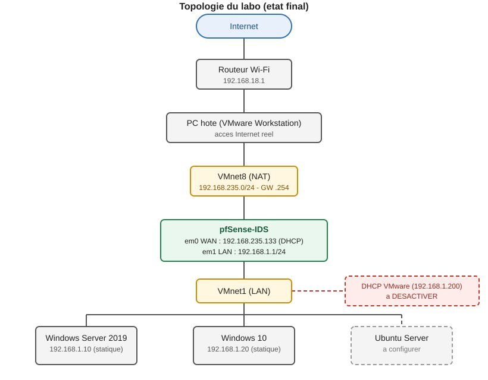
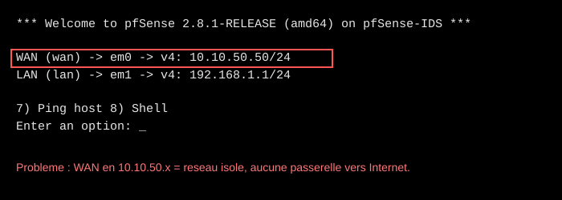
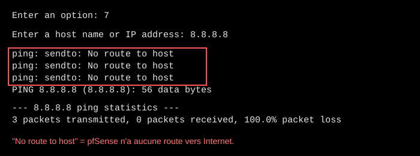
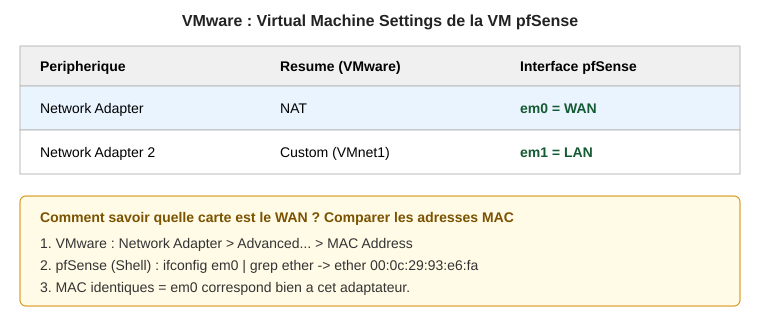
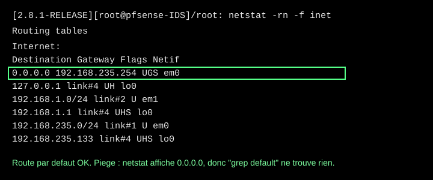
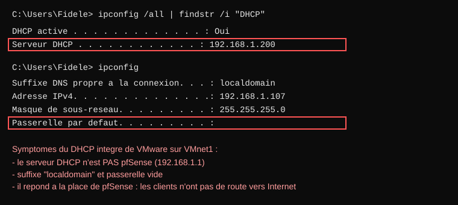
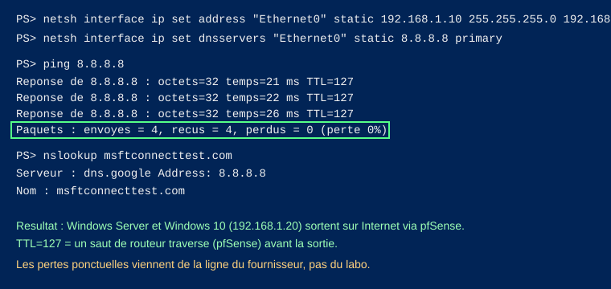

# Labo VMware : donner Internet à Windows Server 2019, Windows 10 et Ubuntu via pfSense

Retour d'expérience sur un incident réseau dans un labo VMware Workstation : les machines virtuelles du LAN n'avaient pas d'accès Internet à travers pfSense. Ce document sert de procédure pour refaire l'installation sans retomber dans les mêmes pièges.



## Sommaire

1. [Contexte](#contexte)
2. [Symptômes](#symptômes)
3. [Les causes trouvées](#les-causes-trouvées)
4. [Procédure de résolution](#procédure-de-résolution)
5. [Commandes de diagnostic utiles](#commandes-de-diagnostic-utiles)
6. [Pièges et fausses pistes](#pièges-et-fausses-pistes)
7. [État final et suite](#état-final-et-suite)

## Contexte

| Élément | Valeur |
|---|---|
| Hyperviseur | VMware Workstation |
| Pare-feu / routeur | pfSense 2.8.1 (avec Suricata), 2 cartes réseau |
| Clients | Windows Server 2019, Windows 10, Ubuntu Server |
| LAN | `192.168.1.0/24`, pfSense en `192.168.1.1` |
| WAN | à déterminer (résultat : NAT VMware, `192.168.235.0/24`) |

Objectif : toutes les VM du LAN sortent sur Internet à travers pfSense.

## Symptômes

Au départ, la console pfSense affichait un WAN sur `10.10.50.50/24` :



Un ping depuis pfSense vers `8.8.8.8` échouait :



## Les causes trouvées

1. **WAN sur un réseau isolé.** L'adaptateur WAN n'était pas en NAT, donc pfSense n'avait aucune passerelle vers Internet.
2. **Un second serveur DHCP répondait sur le LAN.** Le DHCP intégré de VMware sur VMnet1 donnait aux clients une IP sans passerelle, avec le suffixe `localdomain`.
3. **Le DNS Resolver de pfSense (Unbound) renvoyait SERVFAIL.** La cause exacte n'a pas été identifiée. On l'a contourné en donnant `8.8.8.8` directement aux clients.
4. **Facteur aggravant : la ligne Internet du fournisseur est instable** (pings de 20 ms à plus de 2000 ms, y compris depuis le PC physique). Cela provoque des pertes de paquets et des timeouts DNS, sans rapport avec la configuration du labo.

## Procédure de résolution

### Étape 1. Brancher la carte WAN de pfSense en NAT

Dans VMware : clic droit sur la VM pfSense > **Settings** > **Network Adapter** > **NAT**. L'autre carte reste en **Custom: VMnet1** (LAN).

Pour savoir quelle carte VMware correspond à `em0` ou `em1`, on compare les adresses MAC :



Dans le shell pfSense (option `8` du menu) :

```sh
ifconfig em0 | grep ether
```

### Étape 2. Obtenir une IP WAN en DHCP

Test immédiat (temporaire) :

```sh
dhclient em0
ifconfig em0 | grep inet
ping -c 3 8.8.8.8
```

Rendre permanent depuis le menu console : option `2` (Set interface(s) IP address), puis `1` (WAN) :

- Configure IPv4 address WAN via DHCP : **y**
- Configure IPv6 address WAN via DHCP6 : **n**
- Revert to HTTP as the webConfigurator protocol : **n**

Résultat attendu : `WAN (wan) -> em0 -> v4/DHCP4: 192.168.235.x/24`.

### Étape 3. Vérifier la route par défaut

```sh
netstat -rn -f inet
```



Si la route manque, on peut l'ajouter à la main pour tester :

```sh
route add default 192.168.235.254
```

### Étape 4. Repérer le DHCP parasite

Sur un client Windows :

```bat
ipconfig /all | findstr /i "DHCP"
```



Si le « Serveur DHCP » n'est pas `192.168.1.1` (pfSense), un autre DHCP répond. Ici : `192.168.1.200`, le DHCP de VMware sur VMnet1.

Pour le désactiver : sur le PC hôte, **Edit > Virtual Network Editor > Change Settings > VMnet1**, décocher **Use local DHCP service to distribute IP address to VMs**, puis **Apply**.

### Étape 5. Mettre des IP statiques (en attendant un DHCP maîtrisé)

Windows Server (PowerShell) :

```powershell
netsh interface ip set address "Ethernet0" static 192.168.1.10 255.255.255.0 192.168.1.1
netsh interface ip set dnsservers "Ethernet0" static 8.8.8.8 primary
```

Windows 10 (cmd en administrateur) :

```bat
netsh interface ip set address "Ethernet0" static 192.168.1.20 255.255.255.0 192.168.1.1
netsh interface ip set dnsservers "Ethernet0" static 8.8.8.8 primary
```

Test :

```bat
ping 8.8.8.8
ping google.com
```



### Étape 6. Ubuntu Server (non testé pendant l'incident)

Cette partie n'a pas été validée. Exemple de configuration à adapter (`/etc/netplan/00-installer-config.yaml`), en remplaçant `ens33` par le nom réel donné par `ip -br a` :

```yaml
network:
  version: 2
  ethernets:
    ens33:
      dhcp4: no
      addresses: [192.168.1.30/24]
      routes:
        - to: default
          via: 192.168.1.1
      nameservers:
        addresses: [8.8.8.8, 8.8.4.4]
```

Puis `sudo netplan apply`. Vérifier avant que la carte réseau de la VM est en **Custom: VMnet1**.

## Commandes de diagnostic utiles

| But | Commande | Où |
|---|---|---|
| pfSense joint Internet ? | `ping -c 3 8.8.8.8` | shell pfSense |
| Route par défaut | `netstat -rn -f inet` | shell pfSense |
| IP du WAN | `ifconfig em0 \| grep inet` | shell pfSense |
| DNS de pfSense (Unbound) | `host -W 10 google.com 127.0.0.1` | shell pfSense |
| DNS amont | `host -W 10 google.com 8.8.8.8` | shell pfSense |
| Qui a donné l'IP ? | `ipconfig /all \| findstr /i "DHCP"` | Windows |
| Routage vs DNS | `nslookup google.com 8.8.8.8` | Windows |
| Chemin des paquets | `tracert -d -h 4 8.8.8.8` | Windows |

Méthode : tester d'abord par IP (`8.8.8.8`) pour isoler le routage, puis par nom (`google.com`) pour isoler le DNS.

## Pièges et fausses pistes

- **`grep default` ne trouve rien dans `netstat`.** Il affiche `0.0.0.0`, pas le mot « default ». La route était bien là.
- **`ps aux | grep [u]nbound` dit « No match ».** Le shell de pfSense (csh) n'accepte pas cette syntaxe. Utiliser `sockstat -4 -l | grep :53` pour vérifier le service.
- **Checksum offloading, charge CPU/RAM de Suricata, DNSSEC, option « DNS override » :** vérifiés, ce n'étaient pas les causes.
- **Un `ping` qui échoue vers `google.com` n'est pas un test fiable :** Google peut ignorer des pings et la ligne instable crée des pertes. Préférer `nslookup` et `ping 8.8.8.8`.
- **Ne pas éteindre le DHCP de pfSense sans prévoir autre chose :** sans DHCP, les clients prennent une IP du DHCP de VMware (sans passerelle) ou une adresse en `169.254.x.x`.
- **Triangle jaune sur l'icône réseau de Windows :** Windows n'arrive pas à joindre son site de test (`msftconnecttest.com`) à cause de la ligne instable. Sans conséquence si les pings répondent.

## État final et suite

**Fonctionne :**

- pfSense : WAN en DHCP permanent via le NAT VMware, route par défaut en place.
- Windows Server (`192.168.1.10`) et Windows 10 (`192.168.1.20`) sortent sur Internet via pfSense.

**Reste à faire :**

- [ ] Configurer Ubuntu Server.
- [ ] Désactiver le DHCP de VMware sur VMnet1 (étape 4).
- [ ] Installer le rôle DHCP sur Windows Server. Dans l'étendue, ajouter l'option **003 Router** = `192.168.1.1` et l'option **006 DNS Servers** = `8.8.8.8`, `8.8.4.4`, puis remettre les clients en DHCP.
- [ ] Comprendre pourquoi Unbound renvoie SERVFAIL (le contournement par DNS direct suffit pour le labo).
