# Labo VMware : donner Internet à Windows Server 2019, Windows 10 et Ubuntu via pfSense

Retour d'expérience sur un incident réseau dans un labo VMware Workstation : les machines virtuelles du LAN n'avaient pas d'accès Internet à travers pfSense. Ce document sert de procédure pour refaire l'installation sans retomber dans les mêmes pièges.

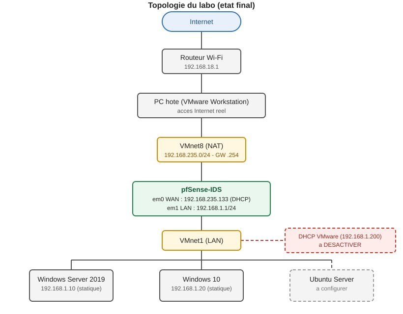

## Sommaire

1. [Contexte](#contexte)
2. [Symptômes](#symptômes)
3. [Les causes trouvées](#les-causes-trouvées)
4. [Procédure de résolution](#procédure-de-résolution)
5. [Incident 2 : la route par défaut de pfSense disparaît](#incident-2--la-route-par-défaut-de-pfsense-disparaît)
6. [Commandes de diagnostic utiles](#commandes-de-diagnostic-utiles)
7. [Pièges et fausses pistes](#pièges-et-fausses-pistes)
8. [État final et suite](#état-final-et-suite)

## Contexte

| Élément | Valeur |
|---|---|
| Hyperviseur | VMware Workstation |
| Pare-feu / routeur | pfSense 2.8.1 (avec Suricata), 2 cartes réseau |
| Clients | Windows Server 2019, Windows 10, Ubuntu Server |
| LAN | `192.168.1.0/24`, pfSense en `192.168.1.1` |
| WAN | à déterminer (résultat : NAT VMware, `192.168.235.0/24`) |

Objectif : toutes les VM du LAN sortent sur Internet à travers pfSense.

## Symptômes

Au départ, la console pfSense affichait un WAN sur `10.10.50.50/24` :

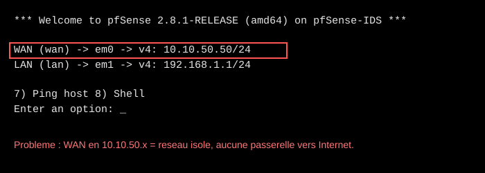

Un ping depuis pfSense vers `8.8.8.8` échouait :

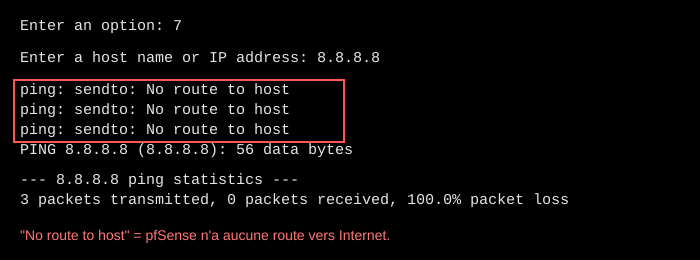

## Les causes trouvées

1. **WAN sur un réseau isolé.** L'adaptateur WAN n'était pas en NAT, donc pfSense n'avait aucune passerelle vers Internet.
2. **Un second serveur DHCP répondait sur le LAN.** Le DHCP intégré de VMware sur VMnet1 donnait aux clients une IP sans passerelle, avec le suffixe `localdomain`.
3. **Le DNS Resolver de pfSense (Unbound) renvoyait SERVFAIL.** La cause exacte n'a pas été identifiée. On l'a contourné en donnant `8.8.8.8` directement aux clients.
4. **Facteur aggravant : la ligne Internet du fournisseur est instable** (pings de 20 ms à plus de 2000 ms, y compris depuis le PC physique). Cela provoque des pertes de paquets et des timeouts DNS, sans rapport avec la configuration du labo.

## Procédure de résolution

### Étape 1. Brancher la carte WAN de pfSense en NAT

Dans VMware : clic droit sur la VM pfSense > **Settings** > **Network Adapter** > **NAT**. L'autre carte reste en **Custom: VMnet1** (LAN).

Pour savoir quelle carte VMware correspond à `em0` ou `em1`, on compare les adresses MAC :

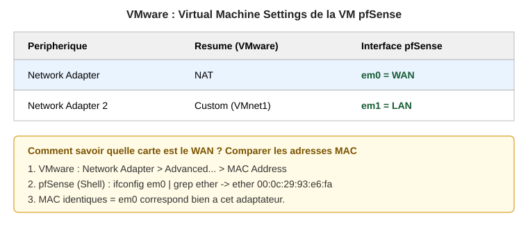

Dans le shell pfSense (option `8` du menu) :

```sh
ifconfig em0 | grep ether
```

### Étape 2. Obtenir une IP WAN en DHCP

Test immédiat (temporaire) :

```sh
dhclient em0
ifconfig em0 | grep inet
ping -c 3 8.8.8.8
```

Rendre permanent depuis le menu console : option `2` (Set interface(s) IP address), puis `1` (WAN) :

- Configure IPv4 address WAN via DHCP : **y**
- Configure IPv6 address WAN via DHCP6 : **n**
- Revert to HTTP as the webConfigurator protocol : **n**

Résultat attendu : `WAN (wan) -> em0 -> v4/DHCP4: 192.168.235.x/24`.

### Étape 3. Vérifier la route par défaut

```sh
netstat -rn -f inet
```

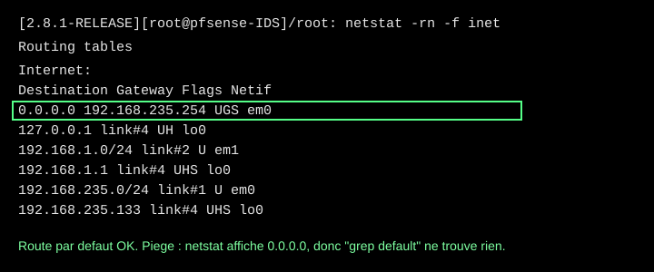

Si la route manque, on peut l'ajouter à la main pour tester :

```sh
route add default 192.168.235.254
```

### Étape 4. Repérer le DHCP parasite

Sur un client Windows :

```bat
ipconfig /all | findstr /i "DHCP"
```

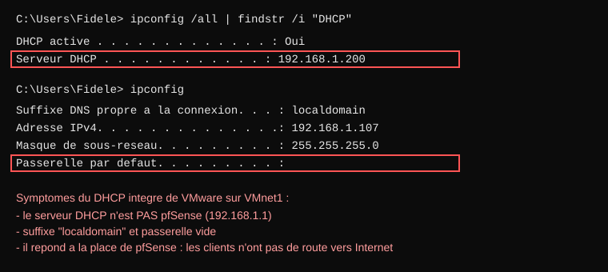

Si le « Serveur DHCP » n'est pas `192.168.1.1` (pfSense), un autre DHCP répond. Ici : `192.168.1.200`, le DHCP de VMware sur VMnet1.

Pour le désactiver : sur le PC hôte, **Edit > Virtual Network Editor > Change Settings > VMnet1**, décocher **Use local DHCP service to distribute IP address to VMs**, puis **Apply**.

### Étape 5. Mettre des IP statiques (en attendant un DHCP maîtrisé)

Windows Server (PowerShell) :

```powershell
netsh interface ip set address "Ethernet0" static 192.168.1.10 255.255.255.0 192.168.1.1
netsh interface ip set dnsservers "Ethernet0" static 8.8.8.8 primary
```

Windows 10 (cmd en administrateur) :

```bat
netsh interface ip set address "Ethernet0" static 192.168.1.20 255.255.255.0 192.168.1.1
netsh interface ip set dnsservers "Ethernet0" static 8.8.8.8 primary
```

Test :

```bat
ping 8.8.8.8
ping google.com
```

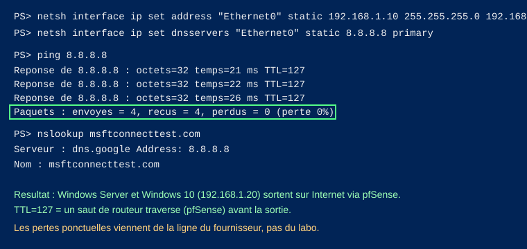

### Étape 6. Ubuntu Server (non testé pendant l'incident)

Cette partie n'a pas été validée. Exemple de configuration à adapter (`/etc/netplan/00-installer-config.yaml`), en remplaçant `ens33` par le nom réel donné par `ip -br a` :

```yaml
network:
  version: 2
  ethernets:
    ens33:
      dhcp4: no
      addresses: [192.168.1.30/24]
      routes:
        - to: default
          via: 192.168.1.1
      nameservers:
        addresses: [8.8.8.8, 8.8.4.4]
```

Puis `sudo netplan apply`. Vérifier avant que la carte réseau de la VM est en **Custom: VMnet1**.

## Incident 2 : la route par défaut de pfSense disparaît

**Contexte.** Plus tard, le rôle DHCP a été installé sur Windows Server. Le client Windows 10 reçoit bien son IP du serveur DHCP, mais n'a plus Internet.

### Étape 1. Constater le symptôme sur le client

```bat
ping 192.168.1.1
ping 8.8.8.8
ping google.com
```

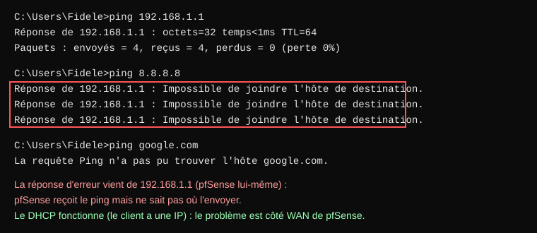

Lecture des résultats :

- `ping 192.168.1.1` répond : le LAN et le DHCP fonctionnent.
- `ping 8.8.8.8` reçoit « Impossible de joindre l'hôte » **de la part de `192.168.1.1`** : c'est pfSense qui refuse, il n'a pas de route vers Internet.
- `ping google.com` échoue parce que le nom n'est pas résolu sans connexion.

Le problème est donc côté WAN de pfSense, pas côté DHCP.

### Étape 2. Tester Internet depuis pfSense

Menu console, option `7` (Ping host), `8.8.8.8`. Résultat : `No route to host`, comme dans l'incident 1 (voir le schéma 03).

### Étape 3. Vérifier l'IP du WAN et la table de routage

Option `8` (Shell) :

```sh
ifconfig em0 | grep inet
netstat -rn -f inet
```

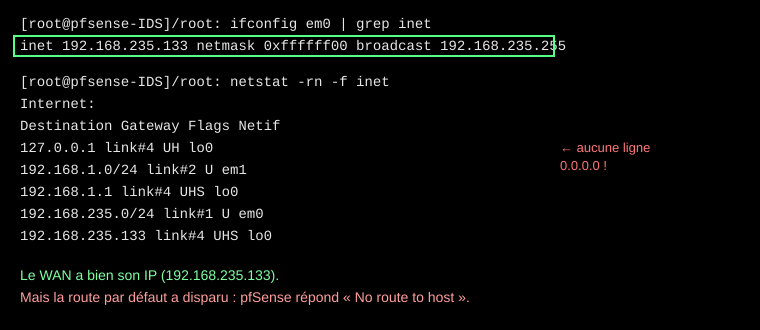

Le WAN a bien son IP (`192.168.235.133`), mais il n'y a plus de ligne `0.0.0.0` dans la table : **la route par défaut a disparu**.

### Étape 4. Tester en remettant une route à la main

```sh
route add default 192.168.235.254
ping -c 3 8.8.8.8
```

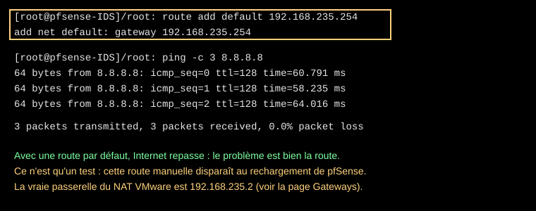

Le ping repasse et le client retrouve Internet. Ça confirme la cause, mais ce n'est qu'un test : une route ajoutée à la main disparaît au rechargement de pfSense. De plus, la vraie passerelle du NAT VMware est `192.168.235.2` (étape 5), pas `.254`.

### Étape 5. Regarder les passerelles dans l'interface web

Ouvrir `https://192.168.1.1`, puis **System > Routing > Gateways**.

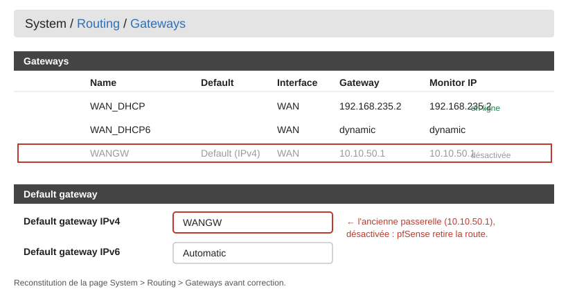

Deux problèmes visibles :

- **Default gateway IPv4 = `WANGW`**, l'ancienne passerelle `10.10.50.1` de l'incident 1. Elle est désactivée (ligne grisée), donc pfSense n'a plus de passerelle par défaut valide et retire la route.
- La passerelle `WAN_DHCP` (`192.168.235.2`) est en ligne mais n'est pas utilisée.

### Étape 6. Corriger la passerelle par défaut

1. Dans **Default gateway IPv4**, choisir **WAN_DHCP** (ou **Automatic**).
2. Cliquer **Save** en bas de la page.
3. Cliquer **Apply Changes** si le bouton apparaît.

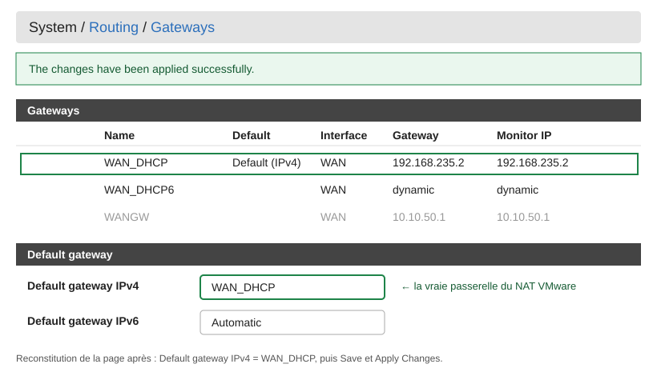

Le message « The changes have been applied successfully » confirme l'application, et `WAN_DHCP` est maintenant `Default (IPv4)`.

### Étape 7. Vérifier la route dans le shell

```sh
netstat -rn -f inet
ping -c 3 8.8.8.8
```

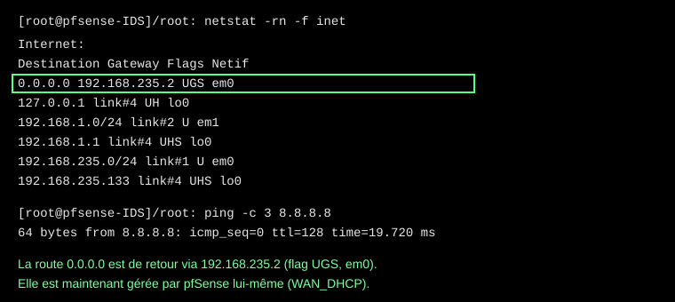

La ligne `0.0.0.0 -> 192.168.235.2` (flag `UGS`) est de retour, cette fois gérée par pfSense.

> Attention : écrire `ping -c 3 8.8.8.8`. Avec `ping - 3` (espace après le tiret), pfSense affiche seulement l'aide de la commande.

### Étape 8. Redémarrer pfSense et revérifier

Pour être sûr que la correction est permanente : menu console, option `5` (Reboot system), puis `y`. Une fois redémarré, refaire l'étape 7 : la ligne `0.0.0.0` doit toujours être là.

### Étape 9. Tester depuis le client Windows 10

```bat
ipconfig /all | findstr /i "DHCP passerelle DNS IPV4"
ping 8.8.8.8
ping google.com
```

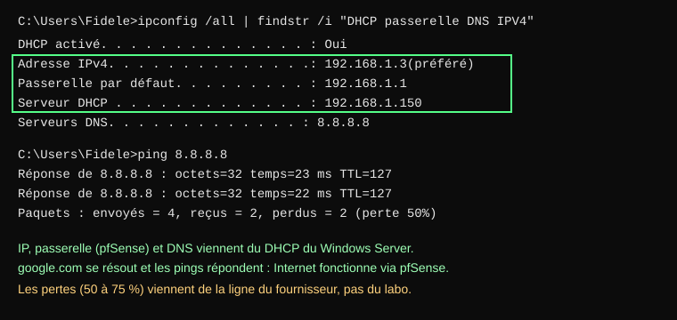

Résultat : IP `192.168.1.3` fournie par le serveur DHCP (`192.168.1.150`), passerelle `192.168.1.1` (pfSense), DNS `8.8.8.8`. `google.com` se résout et les pings répondent, avec des pertes ponctuelles dues à la ligne instable.

### Cause et leçon

Quand on a changé le WAN de `10.10.50.x` vers le DHCP (incident 1), pfSense a gardé l'ancienne passerelle `WANGW` (`10.10.50.1`) comme passerelle par défaut. Tant qu'une route existait, rien ne se voyait. Dès que pfSense a rechargé sa configuration, il a retiré la route par défaut.

**À retenir :** après avoir changé l'adressage du WAN, ouvrir **System > Routing > Gateways** et vérifier que la passerelle par défaut IPv4 est `WAN_DHCP` (ou `Automatic`). Ne jamais se contenter d'une route ajoutée avec `route add`.

## Commandes de diagnostic utiles

| But | Commande | Où |
|---|---|---|
| pfSense joint Internet ? | `ping -c 3 8.8.8.8` | shell pfSense |
| Route par défaut | `netstat -rn -f inet` | shell pfSense |
| Route de test (temporaire) | `route add default 192.168.235.2` | shell pfSense |
| Passerelle par défaut permanente | System > Routing > Gateways | interface web pfSense |
| IP du WAN | `ifconfig em0 \| grep inet` | shell pfSense |
| DNS de pfSense (Unbound) | `host -W 10 google.com 127.0.0.1` | shell pfSense |
| DNS amont | `host -W 10 google.com 8.8.8.8` | shell pfSense |
| Qui a donné l'IP ? | `ipconfig /all \| findstr /i "DHCP"` | Windows |
| Routage vs DNS | `nslookup google.com 8.8.8.8` | Windows |
| Chemin des paquets | `tracert -d -h 4 8.8.8.8` | Windows |

Méthode : tester d'abord par IP (`8.8.8.8`) pour isoler le routage, puis par nom (`google.com`) pour isoler le DNS.

## Pièges et fausses pistes

- **`grep default` ne trouve rien dans `netstat`.** Il affiche `0.0.0.0`, pas le mot « default ». La route était bien là.
- **`ps aux | grep [u]nbound` dit « No match ».** Le shell de pfSense (csh) n'accepte pas cette syntaxe. Utiliser `sockstat -4 -l | grep :53` pour vérifier le service.
- **Checksum offloading, charge CPU/RAM de Suricata, DNSSEC, option « DNS override » :** vérifiés, ce n'étaient pas les causes.
- **Un `ping` qui échoue vers `google.com` n'est pas un test fiable :** Google peut ignorer des pings et la ligne instable crée des pertes. Préférer `nslookup` et `ping 8.8.8.8`.
- **Ne pas éteindre le DHCP de pfSense sans prévoir autre chose :** sans DHCP, les clients prennent une IP du DHCP de VMware (sans passerelle) ou une adresse en `169.254.x.x`.
- **Triangle jaune sur l'icône réseau de Windows :** Windows n'arrive pas à joindre son site de test (`msftconnecttest.com`) à cause de la ligne instable. Sans conséquence si les pings répondent.

## État final et suite

**Fonctionne :**

- pfSense : WAN en DHCP permanent via le NAT VMware, passerelle par défaut `WAN_DHCP` (`192.168.235.2`) gérée par pfSense.
- Windows Server : rôle DHCP installé (`192.168.1.150`), avec la passerelle `192.168.1.1` et le DNS `8.8.8.8` dans l'étendue.
- Windows 10 reçoit son IP du DHCP du serveur et sort sur Internet via pfSense.

**Reste à faire :**

- [ ] Configurer Ubuntu Server (en DHCP, maintenant que le serveur distribue les IP).
- [ ] Vérifier que le DHCP de VMware sur VMnet1 est bien désactivé (étape 4 de l'incident 1), pour éviter tout conflit avec le DHCP du serveur.
- [ ] Comprendre pourquoi Unbound renvoie SERVFAIL (le contournement par DNS direct suffit pour le labo).
