# Installation de Windows Server 2019 dans VMware Workstation 17

Ce projet documente, pas à pas, l'installation de **Windows Server 2019** dans une machine virtuelle **VMware Workstation 17**. Il fait partie d'un laboratoire de formation complète à Windows Server.

> **Les images de ce dépôt sont des reconstitutions schématiques** (fichiers SVG) des écrans rencontrés pendant l'installation. Elles montrent les bons choix, mais ce ne sont pas des captures d'écran réelles.

## Sommaire

1. [Matériel et analyse de faisabilité](#1-matériel-et-analyse-de-faisabilité)
2. [Préparation](#2-préparation)
3. [Création de la machine virtuelle](#3-création-de-la-machine-virtuelle)
4. [Connexion de l'ISO](#4-connexion-de-liso)
5. [Installation de Windows Server 2019](#5-installation-de-windows-server-2019)
6. [Installation de VMware Tools](#6-installation-de-vmware-tools)
7. [Résultat](#7-résultat)
8. [Difficultés rencontrées](#8-difficultés-rencontrées)
9. [Suite du projet](#9-suite-du-projet)

---

## 1. Matériel et analyse de faisabilité

| Élément | Valeur |
|---|---|
| Processeur | Intel Core i5-7200U (2 cœurs, 4 threads) |
| Mémoire | 12 Go de RAM |
| Disque | SSD de 255 Go |
| Hyperviseur | VMware Workstation 17 |

Avant de commencer, j'ai fait le bilan des ressources pour savoir si l'installation était réaliste.

- **RAM** : Windows hôte garde 3 à 4 Go, il reste environ 8 Go pour les VM. Windows Server 2019 avec interface graphique tourne correctement avec 2 Go.
- **Disque** : au départ, seulement 25 Go libres. Il fallait libérer de la place avant toute installation.
- **Processeur** : le i5-7200U est modeste. Deux VM lourdes en parallèle seraient lentes, on n'en lance donc qu'une ou deux à la fois.

Décisions prises :

- Supprimer les VM **Wazuh-SIEM** et **Kali Linux**, qui ne servent pas à cette formation, pour libérer de l'espace.
- Utiliser **Windows 10** plutôt que Windows 11 comme poste client : Windows 11 est plus lourd (TPM, 64 Go de disque, 4 Go de RAM) et plus lent sur ce processeur.
- Utiliser l'édition **Standard (évaluation)** de Windows Server 2019, et non Essentials, qui est limitée (un seul contrôleur de domaine, pas de vrai lab de réplication).

## 2. Préparation

### Libérer l'espace disque

Pour chaque VM à supprimer : éteindre la VM, puis **VM > Manage > Delete from Disk**. L'option « Remove » ne supprime pas les fichiers. Ensuite : vérifier que les dossiers ont disparu, supprimer les archives d'installation dans *Téléchargements*, vider la corbeille et lancer le *Nettoyage de disque*.

Résultat : **93,8 Go libres**, suffisant pour Windows Server 2019 et Windows 10 avec des disques à allocation dynamique.

### Télécharger l'ISO

L'ISO d'évaluation (environ 5 Go) se télécharge depuis le site officiel de Microsoft :

- Page de l'évaluation : <https://www.microsoft.com/en-us/evalcenter/evaluate-windows-server-2019>

Choisir **ISO** (64 bits), remplir le formulaire, puis choisir la langue (ici, le français). L'évaluation est valable **180 jours** et doit être activée par Internet dans les **10 premiers jours**, sinon le serveur s'éteint automatiquement.

## 3. Création de la machine virtuelle

### Étape 1 : lancer l'assistant

Dans VMware : menu **File > New Virtual Machine...** (raccourci `Ctrl+N`).

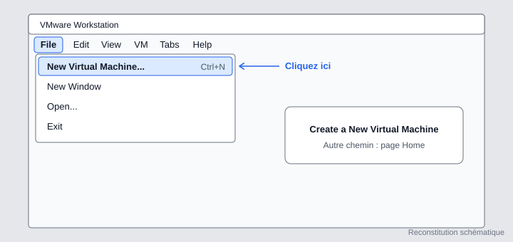

### Étape 2 : choisir « Custom (advanced) »

Le mode *Typical* impose des choix par défaut. Le mode *Custom* permet de contrôler le firmware, le type de disque et ses options, ce qui est utile pour comprendre chaque paramètre.

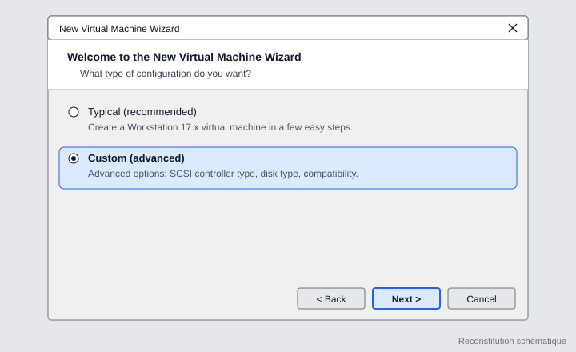

### Étape 3 : installer le système plus tard

On choisit **I will install the operating system later**. L'ISO sera connecté à la main à l'étape 4. Cela évite que VMware lance son « installation facile » et fasse des choix à notre place. Si le champ ISO contient encore le chemin d'une ancienne VM, VMware affiche « Cannot read this file » : choisir cette option règle le problème.

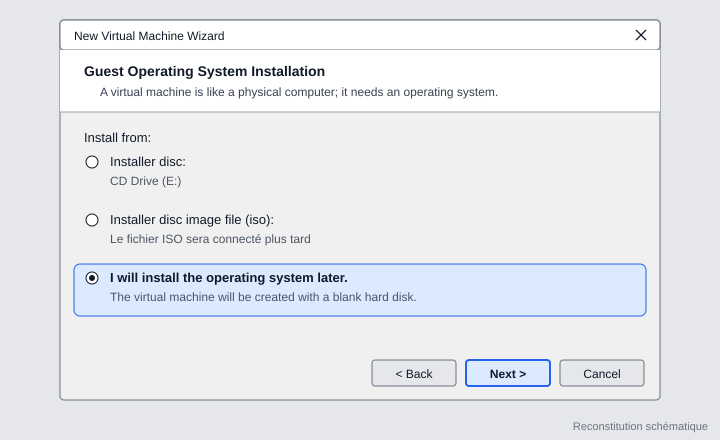

### Étape 4 : système invité

**Microsoft Windows**, version **Windows Server 2019**.

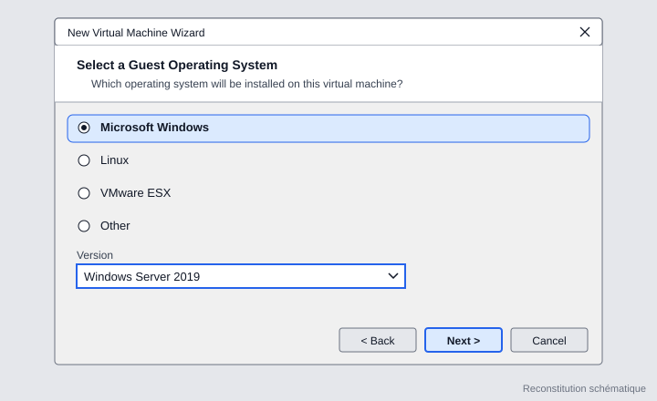

### Étape 5 : nom et emplacement

Nom : `Windows-Server-2019`. L'emplacement par défaut de VMware (dossier *Documents*, sur le SSD) convient.

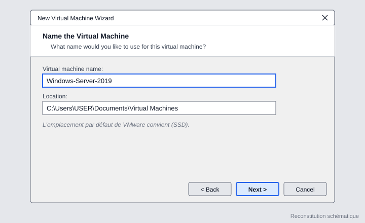

### Étape 6 : type de firmware

**BIOS** est le plus simple pour une première installation. **UEFI** fonctionne aussi avec Windows Server 2019 (Secure Boot peut rester décoché). Pour une formation, ce choix n'a aucun impact sur les modules (AD, DNS, DHCP, GPO).

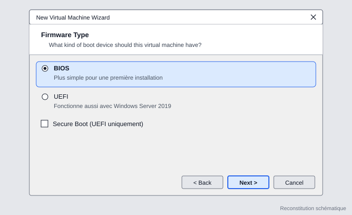

### Étape 7 : processeurs

**1 processeur avec 2 cœurs**, soit 2 cœurs au total : c'est le maximum raisonnable pour un i5-7200U qui n'a que 2 cœurs physiques.

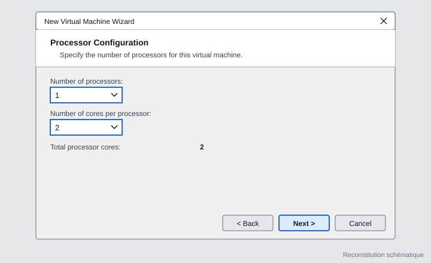

### Étape 8 : mémoire

**2048 Mo (2 Go)**, la valeur recommandée par VMware pour cette version. Il ne faut pas s'approcher du maximum conseillé (9,6 Go) : l'hôte a besoin de sa part. Si le serveur est lent, on peut passer à 3 Go quand la VM est éteinte.

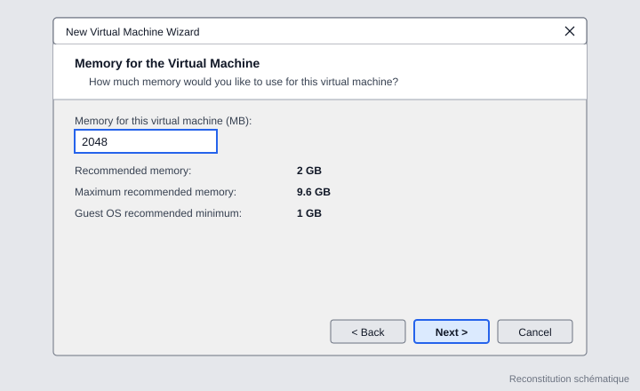

### Étape 9 : réseau

La VM est créée en **Host-only**, de façon provisoire. Le réseau sera ensuite relié au routeur virtuel **pfSense** (voir la section 9). Le mode NAT donnerait à la VM sa propre passerelle et pfSense serait ignoré.

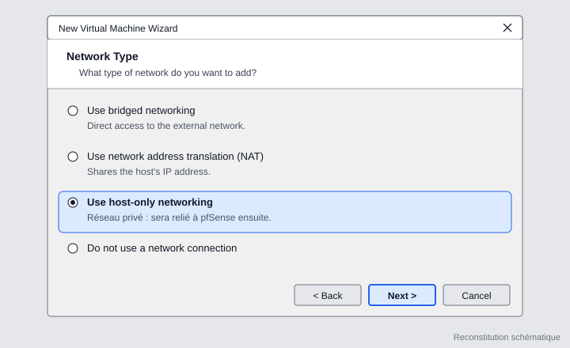

### Étape 10 : contrôleur d'entrées/sorties

**LSI Logic SAS** (recommandé). Windows le reconnaît directement, sans pilote supplémentaire. Éviter *Paravirtualized SCSI*, qui demanderait de charger un pilote pendant l'installation.

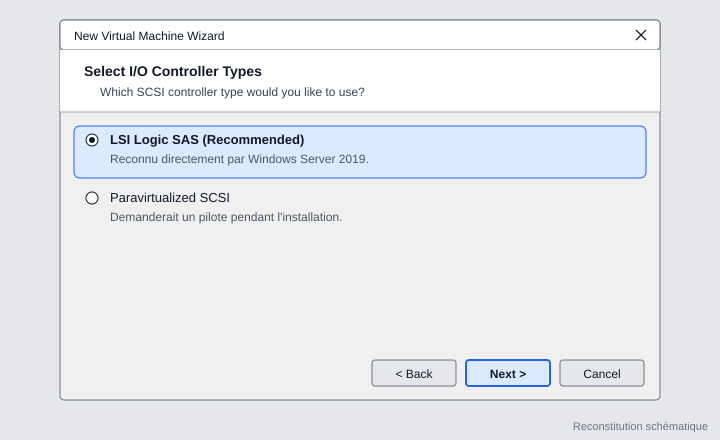

### Étape 11 : type de disque

VMware recommande **NVMe** pour cette VM, et c'est ce qui a été gardé. Windows Server 2019 le gère nativement. Dans ce cas, le contrôleur choisi à l'étape précédente n'est pas utilisé pour le disque, ce qui ne pose aucun problème.

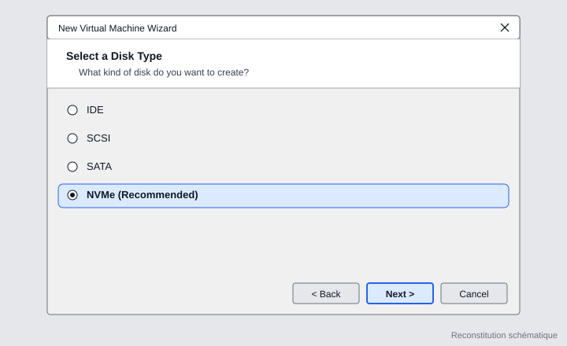

### Étape 12 : disque virtuel

**Create a new virtual disk**.

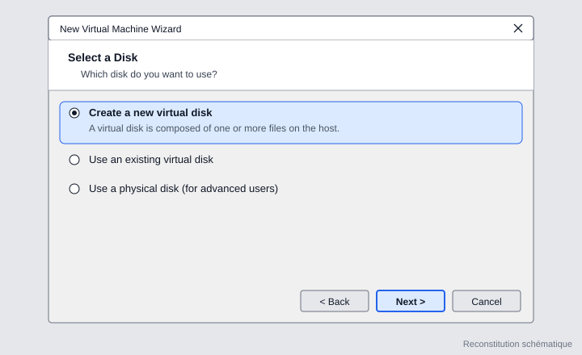

### Étape 13 : capacité du disque

- Taille : **50 Go**.
- **Allocate all disk space now** : **décoché**. Le disque ne prend que l'espace réellement utilisé et grossit au besoin.
- **Store virtual disk as a single file** : plus performant sur SSD que le découpage en plusieurs fichiers.

La valeur par défaut proposée est de 60 Go avec « Split into multiple files » coché : ces deux réglages ont été corrigés.

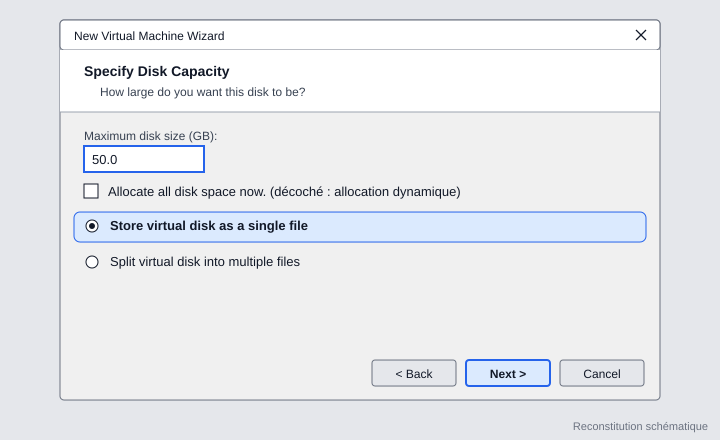

## 4. Connexion de l'ISO

Une fois la VM créée, on ouvre **Edit virtual machine settings**, puis **CD/DVD (SATA)** : on coche **Use ISO image file**, on sélectionne l'ISO de Windows Server 2019 et on vérifie que **Connect at power on** est coché.

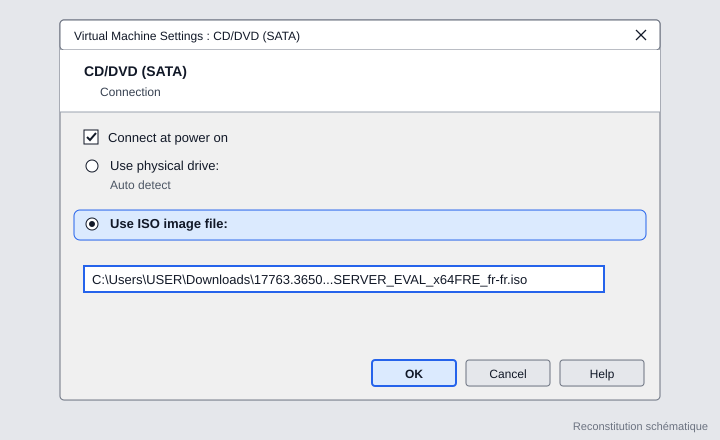

Après avoir validé avec **OK**, la ligne CD/DVD affiche le fichier ISO : la VM est prête à démarrer.

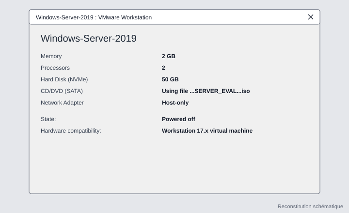

## 5. Installation de Windows Server 2019

### Étape 14 : premier démarrage et langue

Cliquer sur **Power on this virtual machine**. Quand le message « Press any key to boot from CD or DVD » apparaît, cliquer dans la fenêtre de la VM et appuyer sur une touche. L'écran de Windows Setup s'affiche. On choisit la langue, le format horaire et le clavier (ici, tout en français), puis **Suivant**.

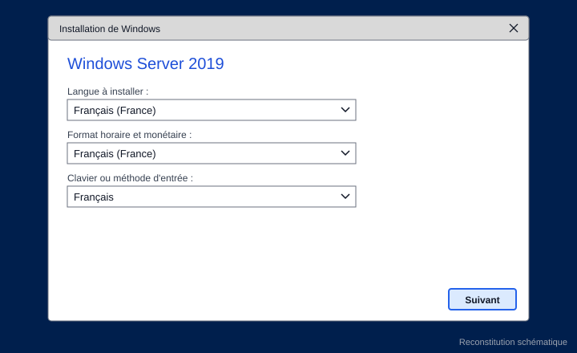

> Le bandeau jaune de VMware « I Finished Installing » peut être ignoré pendant l'installation.

### Étape 15 : choisir l'édition avec interface graphique

C'est l'écran le plus important de l'installation. Il faut choisir **Windows Server 2019 Standard Evaluation (expérience de bureau)**. La première ligne, sans cette mention, installe **Server Core** : pas d'interface graphique, uniquement une invite de commandes, ce qui n'est pas adapté pour débuter.

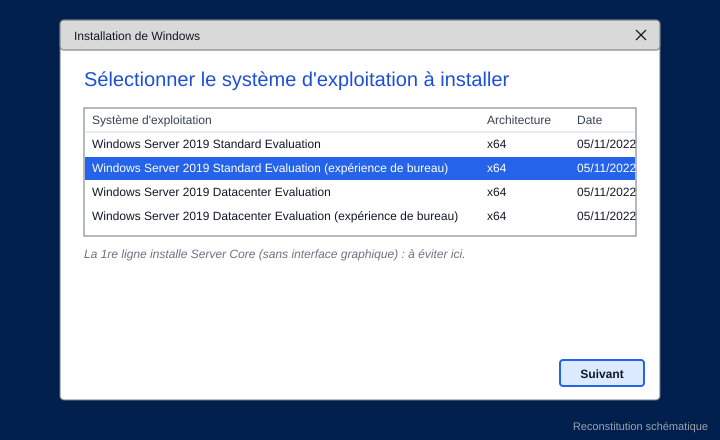

### Étape 16 : type d'installation

**Personnalisé : installer uniquement Windows (avancé)**. L'option de mise à niveau ne fonctionne que si un Windows tourne déjà sur la machine, ce qui n'est pas le cas d'une VM vierge.

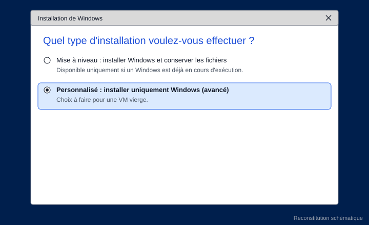

### Étape 17 : disque de destination

Le **Lecteur 0, espace non alloué de 50 Go** apparaît directement : le disque NVMe est reconnu sans pilote. On clique sur **Suivant**, sans toucher aux liens Nouveau ou Formater : Windows crée lui-même les partitions.

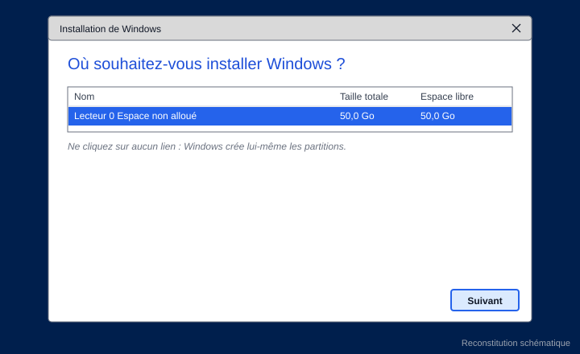

### Étape 18 : installation

La copie des fichiers, l'installation des fonctionnalités et des mises à jour prennent 10 à 25 minutes, avec un ou plusieurs redémarrages automatiques. Si « Press any key to boot from CD or DVD » réapparaît après un redémarrage, **ne rien appuyer** : le disque dur doit prendre le relais.

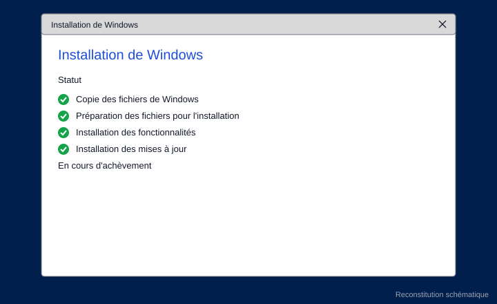

### Étape 19 : mot de passe Administrateur

À la fin, Windows demande le mot de passe du compte **Administrateur**. Il doit faire au moins 8 caractères et contenir trois types parmi : majuscule, minuscule, chiffre, symbole. **Notez-le dans un endroit sûr et ne le publiez jamais** (ni dans ce dépôt, ni dans une capture).

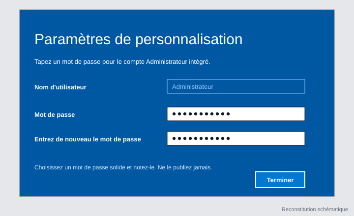

### Étape 20 : première connexion

L'écran de verrouillage demande Ctrl+Alt+Suppr. Il faut utiliser le menu de VMware **VM > Send Ctrl+Alt+Del** : taper les touches sur le clavier serait intercepté par Windows hôte. Ensuite, on saisit le mot de passe.

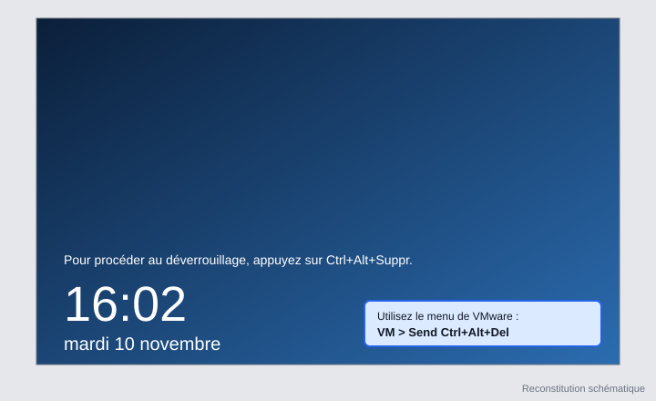

Le **Gestionnaire de serveur** s'ouvre automatiquement : c'est l'outil central de la formation (rôles, fonctionnalités, serveur local). Une fenêtre propose de tester Windows Admin Center : on coche « Ne plus afficher ce message » et on la ferme.

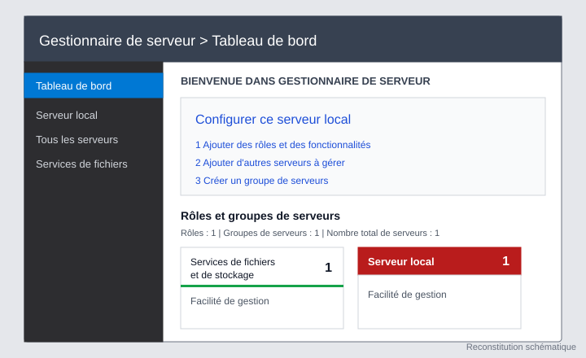

## 6. Installation de VMware Tools

VMware Tools apporte une résolution d'écran adaptée, un presse-papiers partagé et de meilleures performances.

1. Dans VMware : **VM > Install VMware Tools...**
2. Dans la VM, ouvrir l'Explorateur de fichiers, **Ce PC**, puis le lecteur DVD « VMware Tools ».
3. Lancer **setup64.exe** (la version 64 bits) et accepter le contrôle de compte d'utilisateur.
4. Choisir l'installation **Typique**.

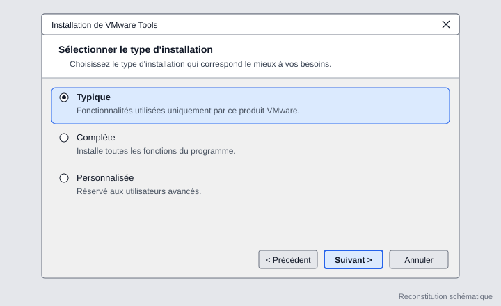

À la fin, VMware Tools demande de redémarrer : cliquer sur **Oui**, puis se reconnecter.

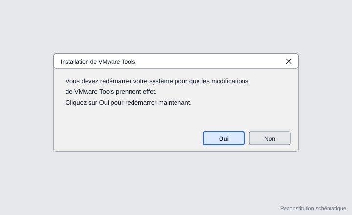

Après le redémarrage, la résolution s'adapte à la fenêtre et la souris passe librement entre la VM et l'hôte.

## 7. Résultat

- Windows Server 2019 Standard (évaluation, expérience de bureau) est installé et fonctionne.
- Le disque C: affichait environ **39,4 Go libres sur 49,4 Go** après installation : Windows Server n'occupe qu'environ **10 Go**.
- VMware Tools est installé.

Il est recommandé de prendre un **snapshot** (**VM > Snapshot > Take Snapshot...**, nommé « Installation propre ») avant toute manipulation du réseau ou des rôles, pour pouvoir revenir à un état sain.

## 8. Difficultés rencontrées

| Problème | Cause | Solution |
|---|---|---|
| Bouton **Next** grisé à l'étape 3 | Le champ ISO contenait le chemin d'un ancien fichier | Choisir « I will install the operating system later » |
| VMware propose UEFI par défaut | Valeur par défaut pour Windows Server 2019 | BIOS ou UEFI fonctionnent tous les deux |
| Disque proposé en 60 Go, fichiers découpés | Valeurs par défaut de l'assistant | Régler 50 Go et « single file » |
| Mauvaise édition présélectionnée | La première ligne de la liste est Server Core | Sélectionner la ligne « expérience de bureau » |
| Indicateur de clavier « FRA / US » à l'écran du mot de passe | La disposition de clavier de l'installateur peut différer de celle choisie | Afficher le mot de passe avec l'icône en forme d'œil avant de valider |
| Réseau avec triangle jaune après l'installation | Aucun accès à Internet en Host-only | Relier la VM au LAN de pfSense (section suivante) |

## 9. Suite du projet

Cette partie est **en cours** et sera documentée une fois validée.

- **pfSense** servira de routeur pour donner accès à Internet aux VM. Son LAN est en `192.168.1.1/24` (VMnet1). Son WAN doit être sur NAT (VMnet8) pour sortir sur Internet : la carte a été changée, mais l'adresse WAN doit encore être passée en DHCP.
- Vérifier le conflit possible entre le DHCP de VMware et celui de pfSense sur VMnet1.
- Régler le réseau de Windows Server, puis tester avec `ping 192.168.1.1`, `ping 8.8.8.8` et `ping google.com`.
- Installer **Windows 10** comme poste client.
- Activer l'évaluation de Windows Server par Internet dans les 10 premiers jours.
