# Projet routage dynamique EIGRP (AS 1)

## Contexte

Deux réseaux locaux, chacun avec deux VLAN, sont reliés par deux routeurs qui échangent leurs routes avec EIGRP (AS 1), sans route statique. Les deux LAN utilisent le router-on-a-stick : le 1841 pour LAN1, le port Gi0 du 819 pour LAN2. Les switches 2960 et 3550 ne font que de la commutation (le 3550 ne supporte ni OSPF ni EIGRP). LAN1 puis LAN2 ont été construits et prouvés chacun par un ping avant de relier les deux et de configurer EIGRP. Les images reproduisent les sorties console relevées lors de la pratique sur du matériel réel. Les fichiers .jpg et .jpeg sont de vraies captures et photos, les fichiers .svg reproduisent les sorties console.

## Objectifs

- Construire LAN1 puis LAN2, chacun prouvé par un ping avant de passer au suivant.
- Configurer EIGRP (AS 1) sur le 1841 et le 819, avec `no auto-summary` et `passive-interface default`.
- Prouver les voisins, les routes `D`, le ping et le tracert de bout en bout.
- Provoquer puis diagnostiquer une panne de voisinage : numéros d'AS différents.
- Comparer RIP, OSPF et EIGRP à partir de la pratique.

## Matériel

| Équipement | Rôle |
|---|---|
| Switch Catalyst 2960 | Accès LAN1 (VLAN 10 et 20), trunk vers le 1841 |
| Routeur Cisco 1841 (R-1841) | Router-on-a-stick pour LAN1, EIGRP |
| Routeur Cisco C819G-4G-GA-K9 (R-819) | Router-on-a-stick pour LAN2 sur Gi0, lien vers le 1841 par Fa0 et SVI Vlan99, EIGRP |
| Switch Catalyst 3550 | Accès LAN2 (VLAN 40 et 50), trunk vers le 819, niveau 2 seulement |
| PC-A | Client LAN1 (VLAN 10), branché sur Fa0/3 du 2960 |
| PC-B | Client LAN2 (VLAN 40), branché sur Fa0/3 du 3550 |

## Plan d'adressage

| VLAN | Nom | Réseau | Passerelle | Portée par |
|---|---|---|---|---|
| 10 | COMPTA | 192.168.10.0/24 | 192.168.10.1 | 1841 Fa0/0.10 |
| 20 | IT | 192.168.20.0/24 | 192.168.20.1 | 1841 Fa0/0.20 |
| 40 | FIN | 192.168.40.0/24 | 192.168.40.1 | 819 Gi0.40 |
| 50 | VENTES | 192.168.50.0/24 | 192.168.50.1 | 819 Gi0.50 |
| 99 | TRANSIT | 10.0.0.0/30 | 10.0.0.1 (1841 Fa0/1) / 10.0.0.2 (819 SVI Vlan99) | Lien entre les routeurs |

| Élément | Valeur |
|---|---|
| PC-A | 192.168.10.10/24, passerelle 192.168.10.1 |
| PC-B | 192.168.40.10/24, passerelle 192.168.40.1 |
| EIGRP | AS 1 sur le 1841 et le 819 |
| Router-ID du 819 | 192.168.50.1 (choisi automatiquement) |

Ports du 2960 : Fa0/1-8 VLAN 10, Fa0/9-16 VLAN 20, Gi0/1 en trunk.
Ports du 3550 : Fa0/1-8 VLAN 40, Fa0/9-16 VLAN 50, Fa0/24 en trunk.
Port du 819 : Fa0 en access VLAN 99 (lien vers le 1841), Gi0 en trunk avec les sous-interfaces Gi0.40 et Gi0.50.

## Topologie

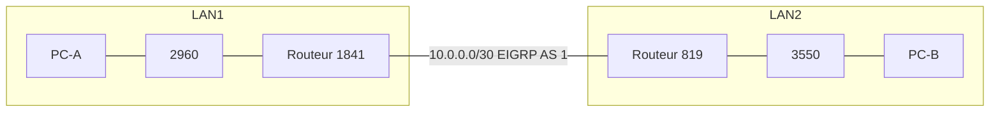

## Ordre de câblage

| Ordre | Liaison | Câble |
|---|---|---|
| 1 | 2960 Gi0/1 vers 1841 Fa0/0 (trunk LAN1) | Droit |
| 2 | PC-A vers 2960 Fa0/3 | Non précisé |
| 3 | 819 Gi0 vers 3550 Fa0/24 (trunk LAN2) | Droit |
| 4 | PC-B vers 3550 Fa0/3 | Non précisé |
| 5 | 1841 Fa0/1 vers 819 Fa0 (lien EIGRP) | Croisé |

LAN1 a été câblé et prouvé en premier, puis LAN2, puis le lien entre les routeurs.

## Commandes tapées

### Effacement avant le projet

Switch 2960 :

```
enable
erase startup-config
reload
show vlan
show startup-config
dir flash:
```

Routeur 1841 :

```
enable
erase startup-config
reload
show startup-config
```

Switch 3550 :

```
enable
erase startup-config
reload
show vlan brief
configure terminal
no vlan 7
no vlan 8
end
show vlan brief
```

Routeur 819 :

```
enable
erase startup-config
reload
delete flash:vlan.dat
show vlan-switch brief
configure terminal
no vlan 7
no vlan 8
end
show vlan-switch brief
```

### Switch 2960

```
enable
configure terminal
hostname SW-2960
vlan 10
 name COMPTA
vlan 20
 name IT
end
show vlan brief
configure terminal
interface range fa0/1-8
 switchport mode access
 switchport access vlan 10
interface range fa0/9-16
 switchport mode access
 switchport access vlan 20
interface gi0/1
 switchport mode trunk
end
show vlan brief
show interfaces gi0/1 switchport
write memory
show startup-config | include hostname|vlan|trunk
dir flash:
show interfaces trunk
show mac address-table dynamic
```

### Routeur 1841

```
enable
configure terminal
hostname R-1841
interface fa0/0
 no shutdown
interface fa0/0.10
 encapsulation dot1Q 10
 ip address 192.168.10.1 255.255.255.0
interface fa0/0.20
 encapsulation dot1Q 20
 ip address 192.168.20.1 255.255.255.0
end
show ip interface brief
show interfaces fastEthernet 0/0 | include address
write memory
show startup-config | include hostname|encapsulation|ip address
configure terminal
interface fa0/1
 ip address 10.0.0.1 255.255.255.252
 no shutdown
end
show ip interface brief
show ip interface brief | include FastEthernet0/1
ping 10.0.0.2
show ip route 192.168.40.10
configure terminal
router eigrp 1
 no auto-summary
 network 10.0.0.0 0.0.0.3
 network 192.168.10.0 0.0.0.255
 network 192.168.20.0 0.0.0.255
 passive-interface default
 no passive-interface fa0/1
end
show ip protocols
write memory
show startup-config | include router|network|passive
show ip eigrp neighbors
show ip route eigrp
```

Le premier `router eigrp 1` tapé seul servait de test : l'IOS du 1841 accepte EIGRP.

### Switch 3550

```
enable
configure terminal
hostname SW-3550
vlan 40
 name FIN
vlan 50
 name VENTES
end
show vlan brief
configure terminal
interface range fa0/1 - 8
 switchport mode access
 switchport access vlan 40
interface range fa0/9 - 16
 switchport mode access
 switchport access vlan 50
interface fa0/24
 switchport trunk encapsulation dot1q
 switchport mode trunk
end
show vlan brief
show interfaces fa0/24 switchport | include Mode
show running-config interface fa0/24
write memory
show startup-config | include hostname|vlan|trunk
dir flash:
show interfaces trunk
show mac address-table dynamic
```

### Routeur 819

```
enable
configure terminal
hostname R-819
vlan 40
 name FIN
vlan 50
 name VENTES
vlan 99
 name TRANSIT
interface gigabitEthernet 0
 no shutdown
interface gigabitEthernet 0.40
 encapsulation dot1Q 40
 ip address 192.168.40.1 255.255.255.0
interface gigabitEthernet 0.50
 encapsulation dot1Q 50
 ip address 192.168.50.1 255.255.255.0
end
show ip interface brief
show interfaces gigabitEthernet 0 | include address
configure terminal
interface fa0
 switchport mode access
 switchport access vlan 99
interface vlan 99
 ip address 10.0.0.2 255.255.255.252
 no shutdown
end
show vlan-switch brief
show ip interface brief
show ip interface brief | include Vlan99
write memory
show startup-config | include hostname|encapsulation|ip address|switchport
dir flash:
configure terminal
router eigrp 1
 no auto-summary
 network 10.0.0.0 0.0.0.3
 network 192.168.40.0 0.0.0.255
 network 192.168.50.0 0.0.0.255
 passive-interface default
 no passive-interface vlan 99
end
show ip protocols
write memory
show startup-config | include router|network|passive
show ip eigrp neighbors
show ip route eigrp
```

Le premier `router eigrp 1` tapé seul servait de test : l'IOS du 819 accepte EIGRP. Le test des sous-interfaces sur le port routé Gi0 a réussi : aucune erreur, et les interfaces passent en up/up une fois le câble branché.

### Incident volontaire sur le 819

```
configure terminal
no router eigrp 1
router eigrp 2
 no auto-summary
 network 10.0.0.0 0.0.0.3
 network 192.168.40.0 0.0.0.255
 network 192.168.50.0 0.0.0.255
 passive-interface default
 no passive-interface vlan 99
end
show ip protocols
```

Réparation :

```
configure terminal
no router eigrp 2
router eigrp 1
 no auto-summary
 network 10.0.0.0 0.0.0.3
 network 192.168.40.0 0.0.0.255
 network 192.168.50.0 0.0.0.255
 passive-interface default
 no passive-interface vlan 99
end
show ip eigrp neighbors
```

### Diagnostic sur le 1841

```
ping 10.0.0.2
show ip route 192.168.40.10
show ip eigrp neighbors
show ip protocols
show ip route eigrp
```

### PC-A et PC-B

```
ipconfig
ping 192.168.10.1
ping 192.168.20.1
ping 192.168.40.1
ping 192.168.50.1
ping 192.168.40.10
ping 10.0.0.2
tracert 192.168.40.10
```

## Captures

### Câblage

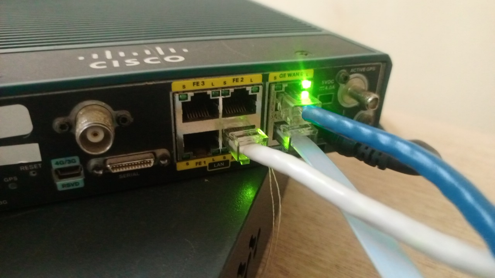

### LAN1 : 2960, 1841 et PC-A

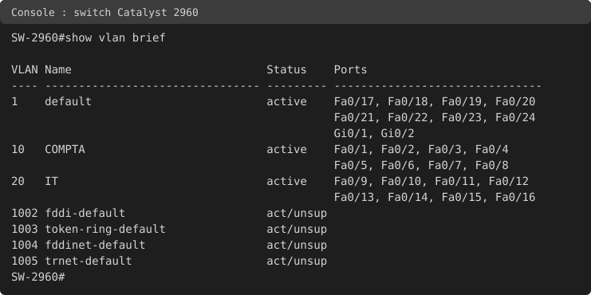

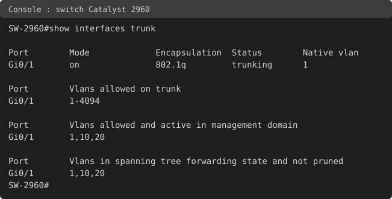

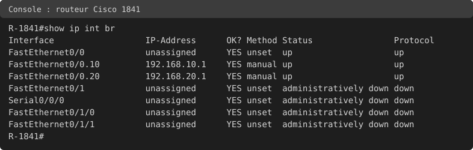

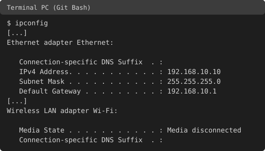


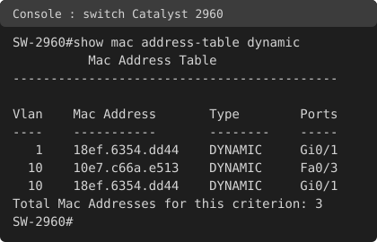

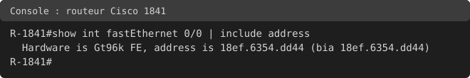

### LAN2 : 3550, 819 et PC-B

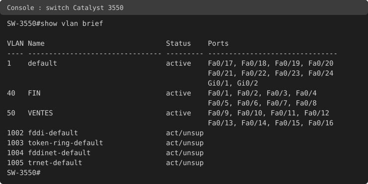

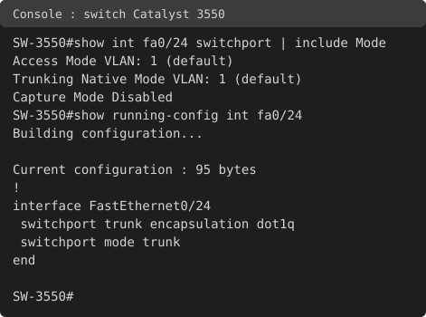

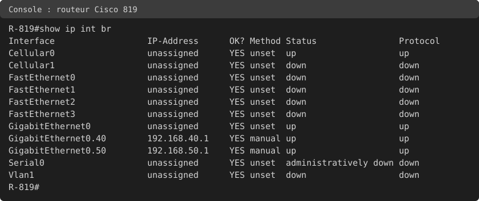

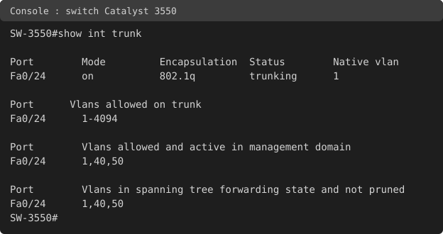

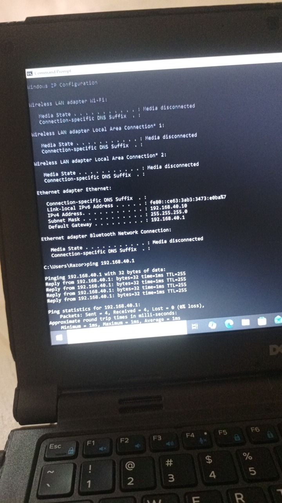

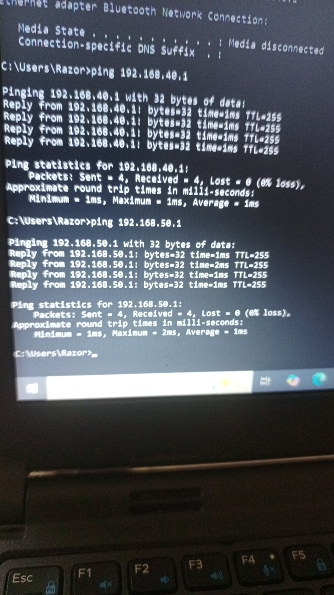

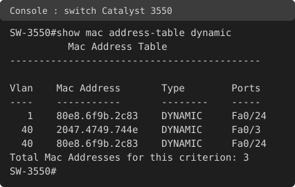

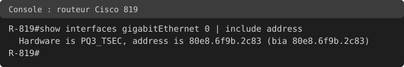

### Lien entre les routeurs

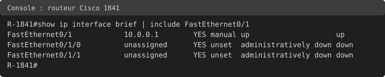

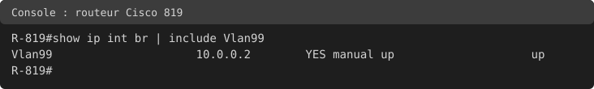

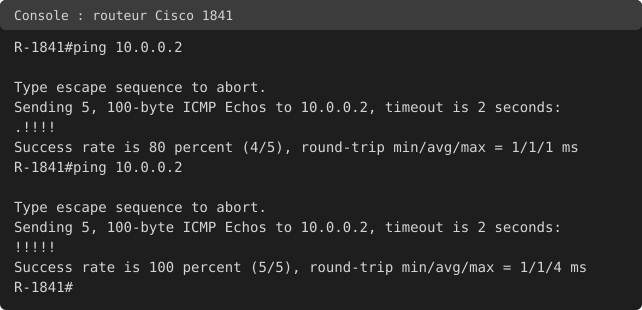

### État de référence avant EIGRP

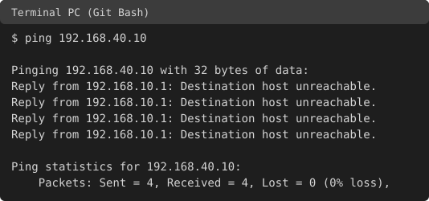

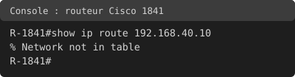

### Configuration EIGRP, voisins et routes

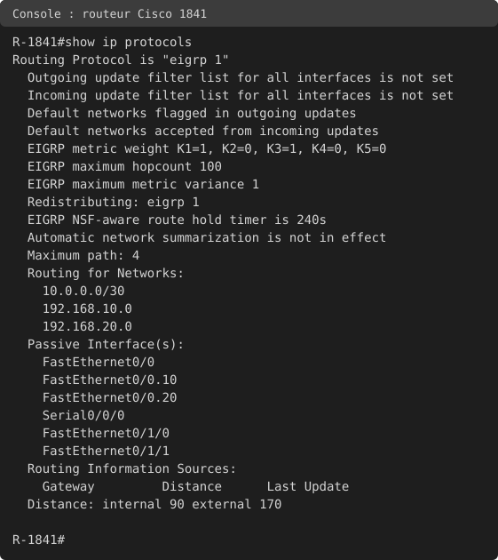

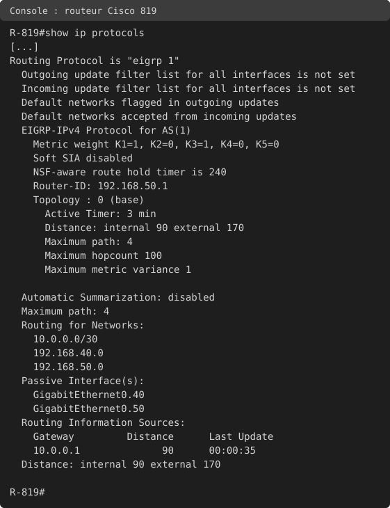

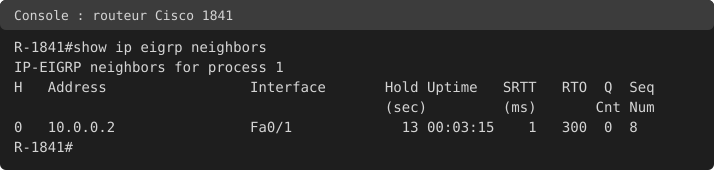

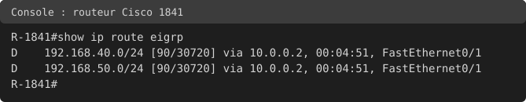

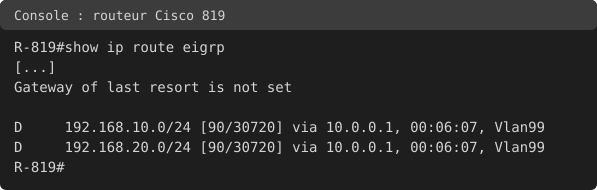

### Perte d'EIGRP après redémarrage

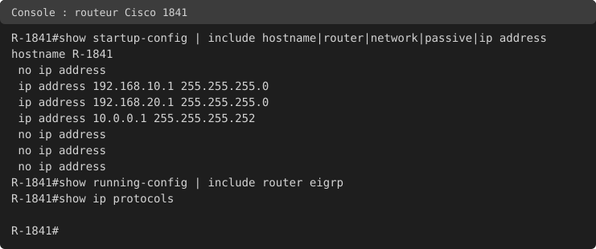

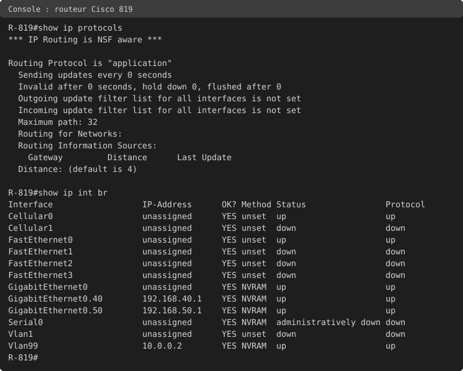

### Tests de bout en bout

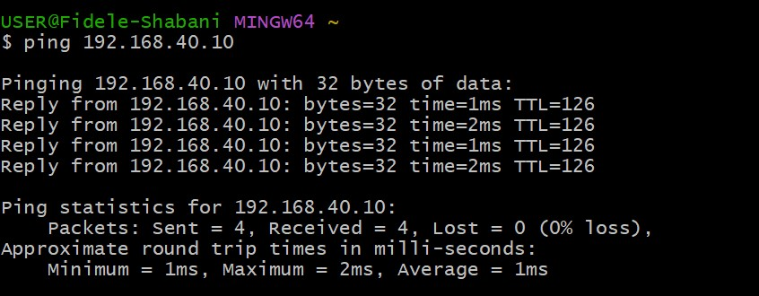

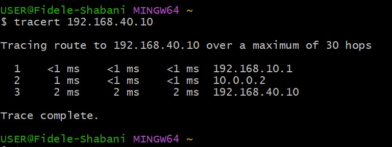

### Incident volontaire : AS différents

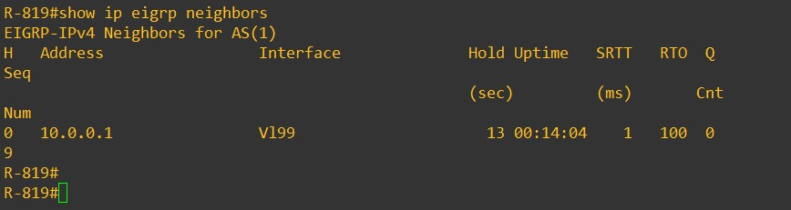

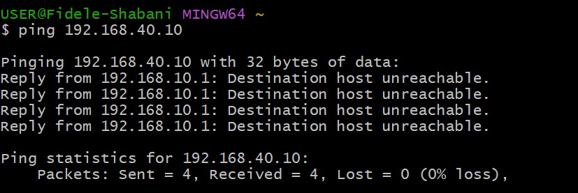

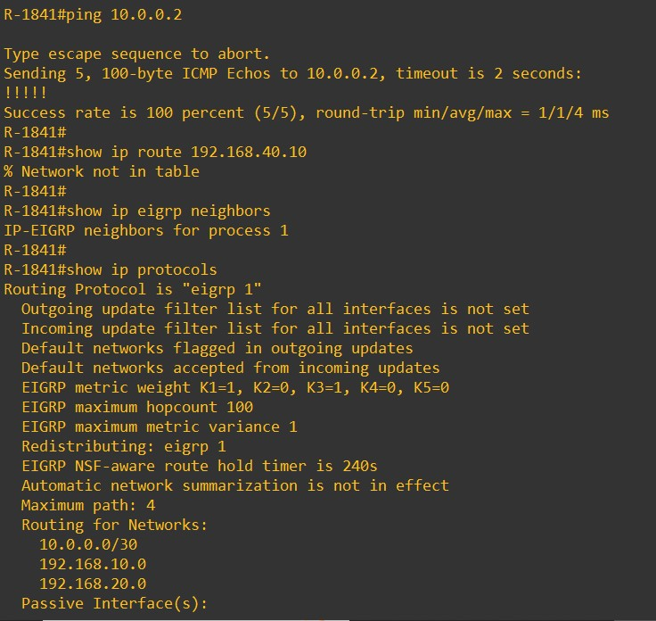

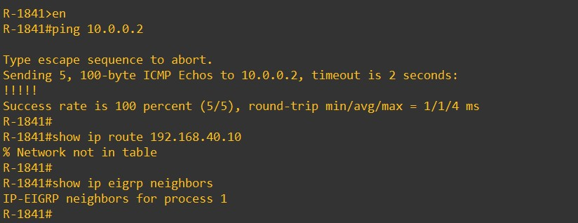

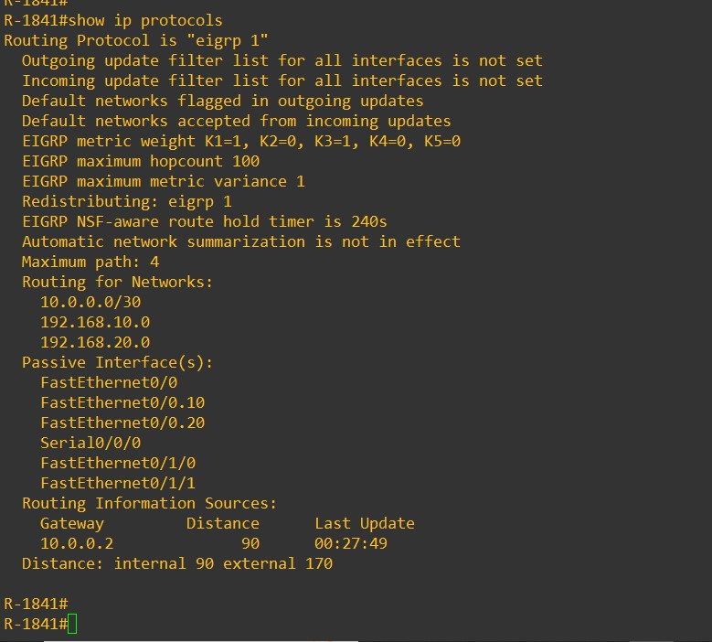

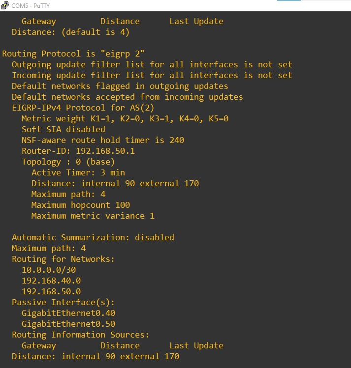

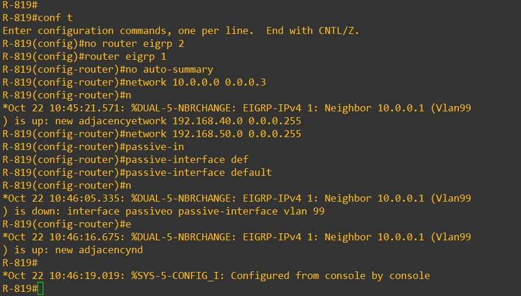

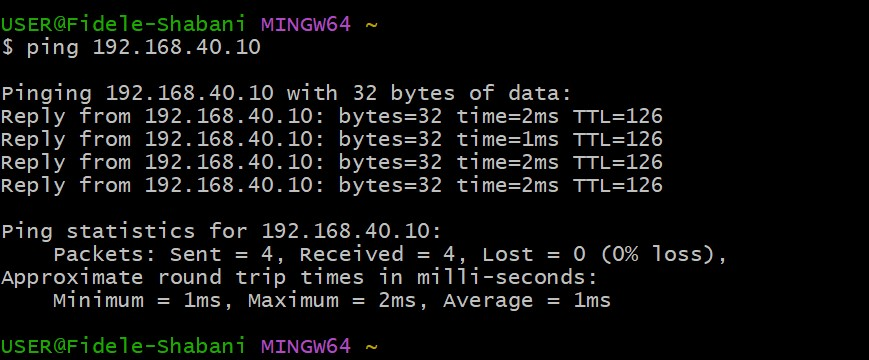

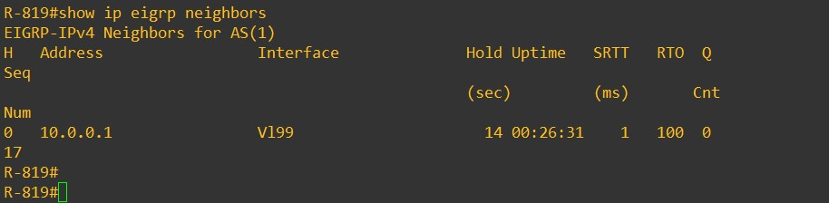

### Faux incident : Wi-Fi de PC-A actif

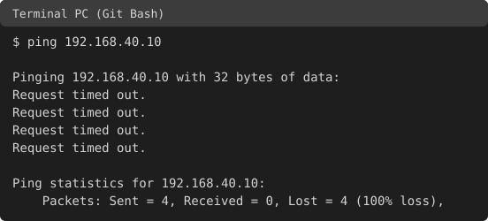

## Incidents rencontrés

### 1. Incident volontaire : numéros d'AS différents

**Action :** sur le 819 (heure du 819 : environ 10:25), `no router eigrp 1` puis `router eigrp 2` avec les mêmes réseaux, sans `write memory`.

**Symptôme :** le ping de PC-A vers PC-B donne 4 "Destination host unreachable" venant de 192.168.10.1. Le résumé "Received = 4" est trompeur : il compte des messages d'erreur du 1841, pas des réponses de PC-B.

**Diagnostic, du bas vers le haut :**

1. Le ping du 1841 vers 10.0.0.2 réussit (5/5) : le lien physique et IP est sain.
2. `show ip route 192.168.40.10` sur le 1841 : `% Network not in table`.
3. `show ip eigrp neighbors` sur le 1841 : aucun voisin.
4. `show ip protocols` : le 1841 est en `eigrp 1`, le 819 en `eigrp 2`.

**Cause :** deux routeurs EIGRP ne forment un voisinage que s'ils ont le même numéro d'AS. Le journal du 819 n'a affiché aucun message de rupture dans la sortie relevée : la rupture est prouvée par la liste de voisins vide.

**Réparation :** `no router eigrp 2` puis `router eigrp 1` avec la configuration d'origine sur le 819. Le journal affiche trois messages : voisin 10.0.0.1 up (10:45:21), down par interface passive (10:46:05), puis up (10:46:16). Le voisin est ensuite stable (uptime 00:26:31).

### 2. Faux incident : Wi-Fi de PC-A actif

Après la réparation, deux pings de PC-A vers PC-B donnent 4 timeouts chacun (aucun "Destination host unreachable"), alors que les voisins et les routes `D` sont corrects sur les deux routeurs. Le ping du 1841 vers PC-B, y compris avec la source 192.168.10.1, réussit, et PC-A joint 10.0.0.2 (TTL 254). Le constat de l'apprenant : le Wi-Fi de PC-A était resté actif. Une fois coupé, le ping donne 4/4, TTL 126. Je n'ai pas relevé d'`ipconfig` pendant les timeouts : la cause repose sur ce constat.

### 3. VLAN restés en mémoire après l'effacement

Après `erase startup-config` et `reload`, `show vlan brief` du 3550 et `show vlan-switch brief` du 819 affichaient encore les VLAN 7 et 8 du projet précédent. Sur le 819, `delete flash:vlan.dat` ne suffisait pas : le fichier avait déjà été chargé en mémoire au redémarrage. Correction : `no vlan 7` et `no vlan 8`, puis un nouveau `show` pour le prouver.

### 4. Perte d'EIGRP après un débranchement

Les deux routeurs avaient EIGRP en configuration en cours, mais il n'avait pas été sauvegardé. Après le débranchement des équipements, `show ip protocols` ne montrait plus EIGRP sur le 1841 (l'horloge du 1841 était repartie de `Jan 1`), ni sur le 819 (les adresses affichaient `NVRAM` dans la colonne Method au lieu de `manual`). Je déduis qu'ils ont redémarré. EIGRP a été reconfiguré et sauvegardé sur les deux, puis prouvé par `show startup-config | include router|network|passive`.

## Tests

| Test | Résultat |
|---|---|
| Ping PC-A vers 192.168.10.1 et 192.168.20.1 | 4/4, TTL 255 (le 1841 répond lui-même) |
| Table MAC du 2960 | MAC de PC-A (10e7.c66a.e513) sur Fa0/3 en VLAN 10 |
| MAC de Fa0/0 du 1841 | 18ef.6354.dd44, vue sur Gi0/1 en VLAN 1 et VLAN 10 |
| Ping PC-B vers 192.168.40.1 et 192.168.50.1 | 4/4, TTL 255 (le 819 répond lui-même) |
| Table MAC du 3550 | MAC de PC-B (2047.4749.744e) sur Fa0/3 en VLAN 40 |
| MAC de Gi0 du 819 | 80e8.6f9b.2c83, vue sur Fa0/24 en VLAN 1 et VLAN 40 |
| Ping du 1841 vers 10.0.0.2 | 1er essai 4/5 (premier paquet perdu), 2e essai 5/5 |
| Avant EIGRP : ping PC-A vers PC-B | 4 "Destination host unreachable" depuis 192.168.10.1 |
| Avant EIGRP : `show ip route 192.168.40.10` sur le 1841 | `% Network not in table` |
| Voisin EIGRP | 10.0.0.2 sur Fa0/1 vu du 1841, 10.0.0.1 sur Vl99 vu du 819 |
| Routes du 1841 | D 192.168.40.0/24 et 192.168.50.0/24, [90/30720] via 10.0.0.2 |
| Routes du 819 | D 192.168.10.0/24 et 192.168.20.0/24, [90/30720] via 10.0.0.1 sur Vlan99 |
| Ping PC-A vers PC-B | 4/4, TTL 126 (128 moins 2 routeurs : 1841 et 819) |
| Tracert PC-A vers PC-B | 192.168.10.1, 10.0.0.2, 192.168.40.10 |
| Incident : 819 en AS 2 | Ping PC-A vers PC-B : 4 "Destination host unreachable", aucun voisin |
| Après réparation et Wi-Fi coupé | Ping PC-A vers PC-B 4/4, TTL 126 |

## Comparaison RIP, OSPF et EIGRP

| | RIP v2 | OSPF | EIGRP |
|---|---|---|---|
| Distance administrative | 120 | 110 | 90 (interne) |
| Métrique observée | `[120/2]` (sauts) | `[110/2]` (coût) | `[90/30720]` (bande passante et délai) |
| Condition pour être voisin | Pas de voisinage formel | Même aire, mêmes Hello/Dead, mêmes masques ; numéro de processus local | Même numéro d'AS |
| Incident provoqué | Interface passive : n'envoie plus, reçoit toujours | Aires différentes : paquets rejetés (`mismatched area ID`) | AS différents : aucun voisin, route disparue |
| Affichage des voisins | `Routing Information Sources` | `show ip ospf neighbor` (FULL, DR/BDR) | `show ip eigrp neighbors` (liste simple) |
| Interface passive | N'envoie plus, reçoit toujours | Non testé en pratique | Voisinage coupé immédiatement |

La vitesse de convergence n'a pas été mesurée avec ce matériel : la théorie annonce EIGRP plus rapide qu'OSPF, lui-même plus rapide que RIP.

## Points ouverts

- Les interfaces Fa0/0 et Fa0/1 du 1841 passent en up/down alors qu'aucun câble n'est branché. Je n'ai pas expliqué ce comportement.
- Le premier paquet du ping du 1841 vers 10.0.0.2 est perdu, puis tout passe. L'hypothèse d'une résolution ARP n'est pas prouvée.
- La métrique 30720 n'a pas été recalculée à la main.
- Le Router-ID du 819 n'a pas été fixé : il a été choisi automatiquement (192.168.50.1).
- Le `write memory` qui a enregistré Fa0/1 du 1841 n'a pas été relevé dans la session. La startup-config le prouve : elle contient 10.0.0.1.
- Les 8 timeouts de PC-A vers PC-B du premier jour (avant la découverte de la perte d'EIGRP) n'ont pas de cause établie. Le symptôme ressemble au faux incident du Wi-Fi, mais ce n'est pas prouvé pour ce cas.
- Les trois captures de diagnostic du 1841 (fichier principal, parties a et b) sont publiées telles quelles.
- Le type de câble des liaisons PC-A / 2960 et PC-B / 3550 n'est pas noté.
- Cellular0 du 819 est up/up alors que la SIM est absente des deux slots (point à reprendre au failover 4G).
- La vitesse de convergence n'a pas été mesurée.

## Ce que j'ai retenu

- EIGRP : distance administrative 90 (interne) et 170 (externe), code `D`, métrique issue de la bande passante et du délai (valeurs K par défaut K1=1, K3=1).
- Deux routeurs ne deviennent voisins que s'ils ont le même numéro d'AS, contrairement à OSPF où le numéro de processus est local.
- `network` accepte un masque inverse, et `no auto-summary` évite le résumé par classe.
- Une interface passive coupe immédiatement le voisinage EIGRP, ce que le journal a montré.
- DUAL garde un successeur et, si elle existe, une route de secours validée (successeur possible).
- Une configuration non sauvegardée est perdue au redémarrage : `write memory`, puis la prouver avec `show startup-config | include ...`.
- Après un effacement, les VLAN peuvent rester en mémoire : vérifier par `show vlan brief` ou `show vlan-switch brief`.
- "Received = 4" ne suffit pas : lire l'origine de chaque ligne de ping, le TTL indique le nombre de routeurs traversés, et vérifier que le Wi-Fi du PC est coupé avant de dépanner les routeurs.
- Dépannage du bas vers le haut, et preuve de la réparation par un test.

## Compétences démontrées

- Construction par étapes de deux LAN en router-on-a-stick sur deux routeurs différents.
- Configuration d'EIGRP sur deux routeurs, avec voisinage et routes prouvés.
- Lecture de `show ip eigrp neighbors`, `show ip route eigrp` et `show ip protocols`.
- Diagnostic structuré d'une panne de voisinage et d'une configuration perdue.
- Comparaison argumentée de trois protocoles de routage dynamique.
- Documentation technique reproductible.

## Remise en état

Sur les switches 2960 et 3550 : `erase startup-config`, `delete flash:vlan.dat`, `reload` (réponse "no" à la sauvegarde). Sur le 819 : mêmes commandes, puis vérifier `show vlan-switch brief` et retirer les VLAN restés en mémoire avec `no vlan`. Sur le 1841 : `erase startup-config` puis `reload`. Sur les PC : remettre l'Ethernet en IP automatique et réactiver le Wi-Fi.
