# Projet routage dynamique OSPF (aire 0)

## Contexte

Deux réseaux locaux, chacun avec deux VLAN, sont reliés par deux routeurs qui échangent leurs routes avec OSPF en aire unique (aire 0), sans route statique. Le switch Catalyst 3550 ne supporte ni OSPF ni EIGRP (image SMI) : il est utilisé comme simple switch de niveau 2. Les images reproduisent les sorties console relevées lors de la pratique sur du matériel réel. Les deux photos de PC-B sont de vraies captures.

## Objectifs

- Tester si le 3550 accepte OSPF et EIGRP, et adapter la topologie selon le résultat.
- Configurer OSPF en aire 0 sur le routeur 1841 et sur le routeur 819, avec des Router ID fixés à la main.
- Annoncer les réseaux avec `network` (masque inverse) et limiter les Hello avec `passive-interface default`.
- Prouver le voisinage (état FULL), les routes `O`, un ping et un tracert de bout en bout.
- Provoquer puis diagnostiquer une panne de voisinage : aires différentes sur un lien.

## Matériel

| Équipement | Rôle |
|---|---|
| Switch Catalyst 2960 | Accès LAN1 (VLAN 2 et 3), trunk vers le 1841 |
| Routeur Cisco 1841 (R-1841) | Router-on-a-stick pour LAN1, OSPF |
| Routeur Cisco C819G-4G-GA-K9 (R-819) | Passerelles de LAN2 par SVI, OSPF |
| Switch Catalyst 3550 | Switch de niveau 2 pour LAN2, trunk vers le 819 |
| PC-A | Client LAN1 (VLAN 2) |
| PC-B | Client LAN2 (VLAN 7) |

## Plan d'adressage

| VLAN | Nom | Réseau | Passerelle | Portée par |
|---|---|---|---|---|
| 2 | ADMIN | 192.168.2.0/24 | 192.168.2.1 | 1841 Fa0/0.2 |
| 3 | LABO | 192.168.3.0/24 | 192.168.3.1 | 1841 Fa0/0.3 |
| 7 | VENTES | 192.168.7.0/24 | 192.168.7.1 | 819 SVI Vlan7 |
| 8 | TECH | 192.168.8.0/24 | 192.168.8.1 | 819 SVI Vlan8 |

| Élément | Valeur |
|---|---|
| Lien 1841 Fa0/1 vers 819 Gi0 | 10.0.0.0/30 : 10.0.0.1 (1841) / 10.0.0.2 (819) |
| Router ID du 1841 | 1.1.1.1 |
| Router ID du 819 | 2.2.2.2 |
| PC-A | 192.168.2.10/24, passerelle 192.168.2.1 |
| PC-B | 192.168.7.10/24, passerelle 192.168.7.1 |

Ports du 2960 : Fa0/1-8 VLAN 2, Fa0/9-16 VLAN 3, Gi0/1 en trunk.
Ports du 3550 : Fa0/1-8 VLAN 7, Fa0/9-16 VLAN 8, Fa0/24 en trunk.
Port du 819 : Fa0 en trunk, les VLAN 7 et 8 sont portés par les SVI.

## Topologie

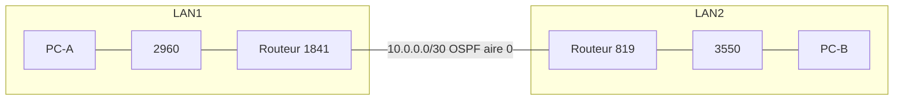

## Ordre de câblage

| Ordre | Liaison | Câble |
|---|---|---|
| 1 | 2960 Gi0/1 vers 1841 Fa0/0 (trunk) | Droit |
| 2 | 1841 Fa0/1 vers 819 Gi0 | Croisé (selon la consigne donnée, non reconfirmé) |
| 3 | 819 Fa0 vers 3550 Fa0/24 (trunk) | Croisé |
| 4 | PC-A vers 2960 Fa0/1 | Non précisé |
| 5 | PC-B vers 3550 Fa0/1 | Non précisé |

Le câblage a été fait par étapes, avec une preuve après chaque lien : lien entre routeurs, puis LAN1, puis LAN2.

## Commandes tapées

### Effacement avant le projet

Switch 2960 et switch 3550 :

```
enable
erase startup-config
delete flash:vlan.dat
reload
```

Routeur 1841 :

```
enable
erase startup-config
reload
```

Routeur 819 :

```
enable
erase startup-config
delete flash:vlan.dat
reload
```

À chaque reload, réponse "no" à la sauvegarde. Contrôle après : `show vlan brief` (switches), `show vlan-switch brief` (819), `show startup-config`.

### Switch 3550 : test du support OSPF et EIGRP

```
enable
configure terminal
router ospf 1
router eigrp 1
```

Les deux commandes répondent `Unknown routing protocol`.

### Switch 2960

```
enable
configure terminal
hostname SW-2960
vlan 2
 name ADMIN
vlan 3
 name LABO
end
show vlan brief
configure terminal
interface range fa0/1-8
 switchport mode access
 switchport access vlan 2
interface range fa0/9-16
 switchport mode access
 switchport access vlan 3
interface gi0/1
 switchport mode trunk
end
show vlan brief
show interfaces gi0/1 switchport | include Mode
write memory
show startup-config | include hostname|vlan|trunk
dir flash:
show interfaces trunk
```

### Switch 3550

```
enable
configure terminal
hostname SW-3550
vlan 7
 name VENTES
vlan 8
 name TECH
end
show vlan brief
configure terminal
interface range fa0/1 - 8
 switchport mode access
 switchport access vlan 7
interface range fa0/9 - 16
 switchport mode access
 switchport access vlan 8
interface fa0/24
 switchport trunk encapsulation dot1q
 switchport mode trunk
end
show vlan brief
show interfaces fa0/24 switchport | include Mode
write memory
show startup-config | include hostname|vlan|trunk
dir flash:
show interfaces trunk
```

### Routeur 1841

```
enable
configure terminal
hostname R-1841
interface fa0/0
 no shutdown
interface fa0/0.2
 encapsulation dot1Q 2
 ip address 192.168.2.1 255.255.255.0
interface fa0/0.3
 encapsulation dot1Q 3
 ip address 192.168.3.1 255.255.255.0
end
show ip interface brief
configure terminal
interface fa0/1
 ip address 10.0.0.1 255.255.255.252
 no shutdown
router ospf 1
 router-id 1.1.1.1
 network 10.0.0.0 0.0.0.3 area 0
 network 192.168.2.0 0.0.0.255 area 0
 network 192.168.3.0 0.0.0.255 area 0
 passive-interface default
 no passive-interface fa0/1
end
show ip interface brief
show ip protocols
write memory
show startup-config | include hostname|router|network|passive|ip
show startup-config | include encapsulation|shutdown
```

### Routeur 819

```
enable
configure terminal
router ospf 1
end
configure terminal
no router ospf 1
hostname R-819
vlan 7
 name VENTES
vlan 8
 name TECH
interface fa0
 switchport mode trunk
end
show vlan-switch brief
show running-config interface fa0
configure terminal
interface gigabitEthernet 0
 ip address 10.0.0.2 255.255.255.252
 no shutdown
interface vlan 7
 ip address 192.168.7.1 255.255.255.0
 no shutdown
interface vlan 8
 ip address 192.168.8.1 255.255.255.0
 no shutdown
router ospf 1
 router-id 2.2.2.2
 network 10.0.0.0 0.0.0.3 area 0
 network 192.168.7.0 0.0.0.255 area 0
 network 192.168.8.0 0.0.0.255 area 0
 passive-interface default
 no passive-interface GigabitEthernet0
end
show ip interface brief
show ip protocols
write memory
show startup-config | include hostname|router|network|passive|ip address|switchport
dir flash:
```

Le premier `router ospf 1` sert au test : il affiche `%OSPF-4-NORTRID`, car aucune interface n'a encore d'adresse IP pour fabriquer un Router ID. Le processus de test est supprimé avant la vraie configuration.

### Vérifications après le câblage

Routeur 1841 :

```
show ip interface brief | include FastEthernet0/1
show ip ospf neighbor
show ip ospf interface fa0/1
show ip route
show ip ospf database
show ip interface brief | include FastEthernet0/0
show ip route ospf
```

Routeur 819 :

```
show ip interface brief | include GigabitEthernet0
show ip ospf neighbor
show ip route ospf
show ip interface brief | include Vlan
```

### PC-A et PC-B

```
ipconfig
ping 192.168.2.1
ping 192.168.7.1
ping 192.168.7.10
tracert 192.168.7.10
```

## Captures

### Le 3550 ne supporte pas OSPF

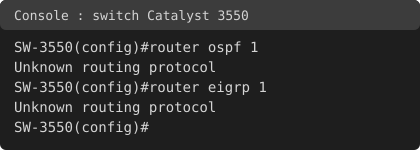

### Switches : VLAN et trunks

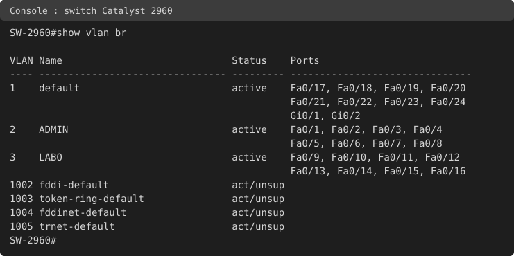

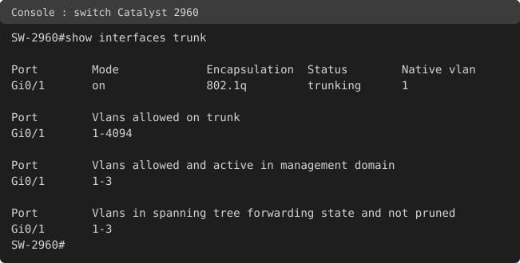


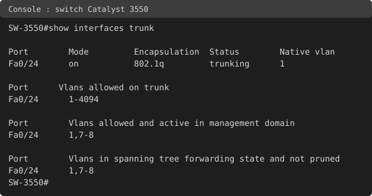

### Configuration OSPF

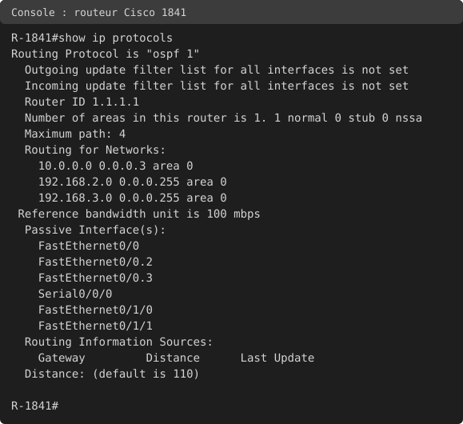

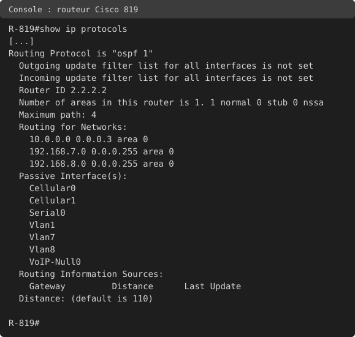

### Voisinage OSPF

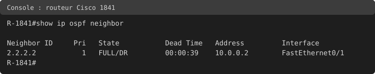

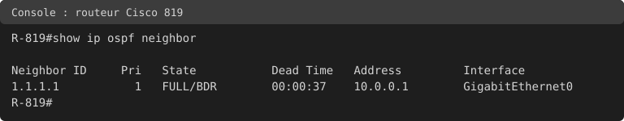

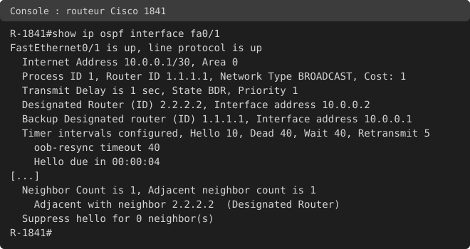

### Routes OSPF, étape par étape

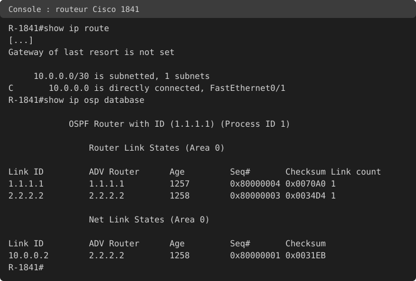

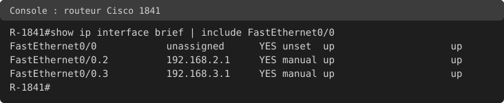

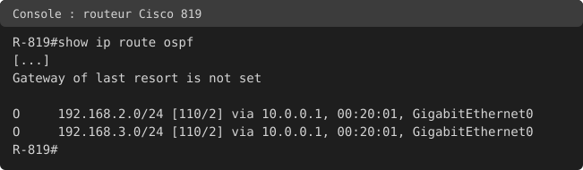

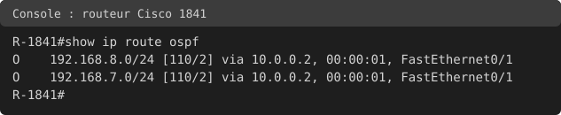

### Tests de bout en bout

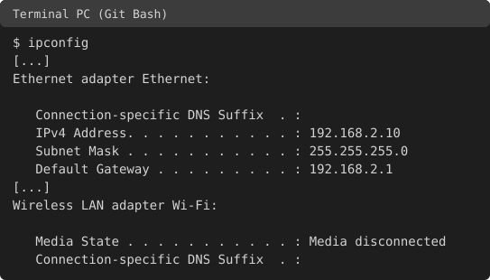


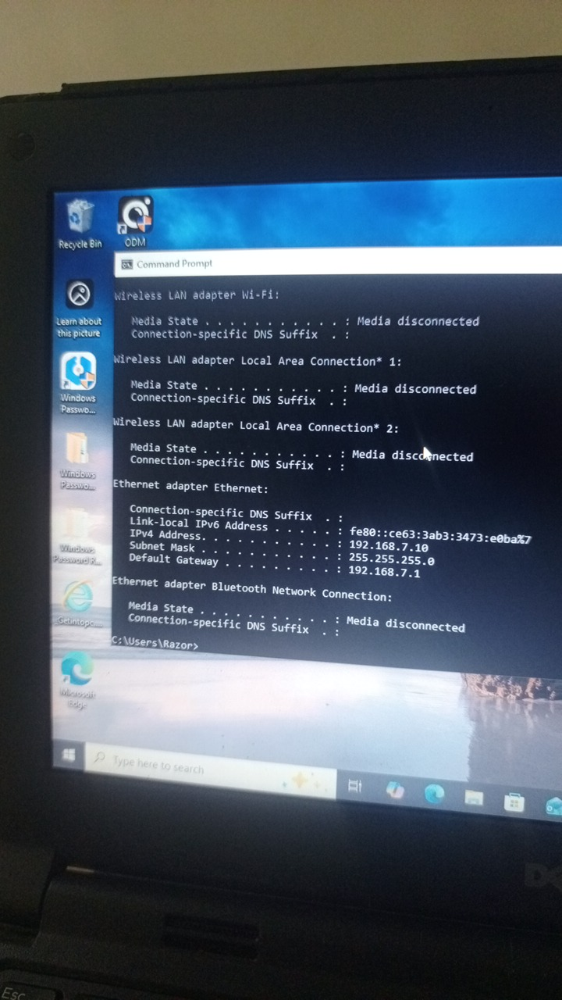

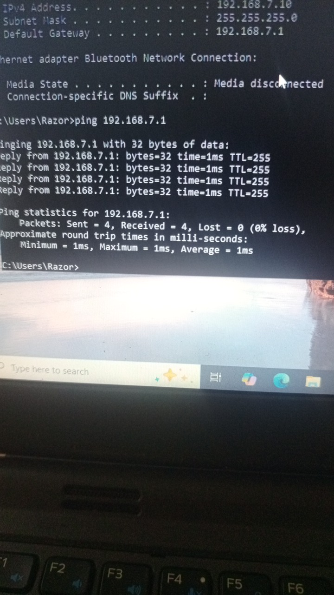

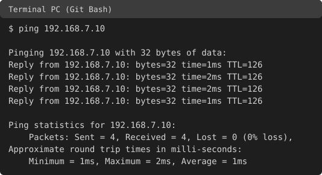


### Incident volontaire

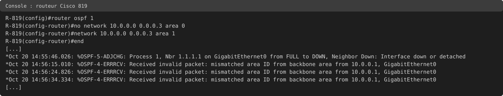

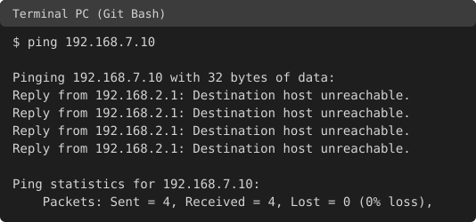

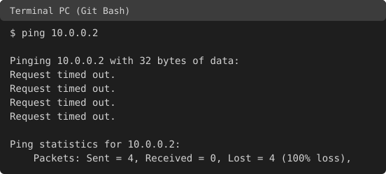

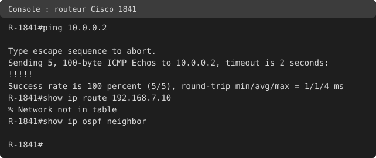

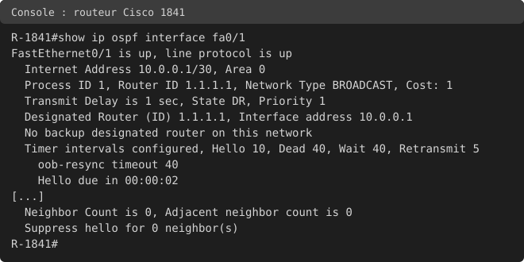

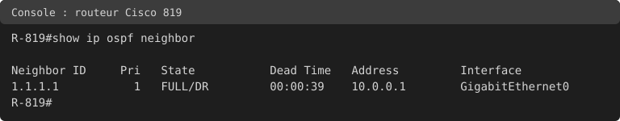


## Incident volontaire : aires différentes sur le lien

**Action :** sur le 819 (heure du 819 : 14:55:46), `no network 10.0.0.0 0.0.0.3 area 0` puis `network 10.0.0.0 0.0.0.3 area 1`, sans `write memory`.

**Symptôme :** le ping de PC-A vers PC-B (192.168.7.10) donne 4 "Destination host unreachable" venant de 192.168.2.1. Le résumé "Received = 4" est trompeur : il compte des messages d'erreur du 1841, pas des réponses de PC-B. Un ping de PC-A vers 10.0.0.2 donne de vrais timeouts.

**Diagnostic, du bas vers le haut :**

1. Journal du 819 : le voisin 1.1.1.1 passe de FULL à DOWN (`Interface down or detached`), puis le message `mismatched area ID` revient environ toutes les 10 secondes, au rythme des Hello.
2. Couche 3 : le ping du 1841 vers 10.0.0.2 réussit (5/5). Le lien physique et IP est sain.
3. `show ip route 192.168.7.10` sur le 1841 : `% Network not in table`. La route apprise par OSPF a disparu.
4. `show ip ospf neighbor` sur le 1841 : aucune ligne. Le voisinage est rompu.
5. `show ip ospf interface fa0/1` sur le 1841 : Area 0, Hello 10 et Dead 40 inchangés, `Neighbor Count is 0`. Les timers sont identiques des deux côtés : la différence porte sur l'aire.

**Cause :** les deux extrémités du lien n'étaient plus dans la même aire (le 1841 en aire 0, le 819 configuré en aire 1). OSPF rejette les paquets Hello dont l'aire ne correspond pas, donc aucune adjacence ne se forme. L'aire du 819 est établie par la configuration tapée et par le journal, pas par un `show ip ospf interface` sur le 819.

**Réparation :** `no network 10.0.0.0 0.0.0.3 area 1` puis `network 10.0.0.0 0.0.0.3 area 0` sur le 819. Le voisin 1.1.1.1 repasse en FULL et le ping de PC-A vers PC-B refonctionne : 4/4, TTL 126.

**Observation :** avant l'incident, le 819 était DR et le 1841 BDR. Après la réparation, le 1841 est DR. Resté seul sur le segment pendant la panne, il s'est élu DR, et l'élection n'est pas refaite à la reconnexion.

Rien n'a été sauvegardé pendant l'incident : la configuration réparée est identique à la startup-config.

## Tests

| Test | Résultat |
|---|---|
| `router ospf 1` et `router eigrp 1` sur le 3550 | `Unknown routing protocol` pour les deux |
| Voisinage vu du 1841 | 2.2.2.2, FULL/DR, interface Fa0/1 |
| Voisinage vu du 819 | 1.1.1.1, FULL/BDR, interface Gi0 |
| Interface Fa0/1 du 1841 | Area 0, type BROADCAST, coût 1, Hello 10, Dead 40 |
| Table du 1841 avant l'activation des LAN | Une seule route : C 10.0.0.0/30 |
| Base OSPF du 1841 avant l'activation des LAN | 2 LSA de type 1 (Link count 1 chacun) et 1 LSA de type 2 émis par 2.2.2.2 |
| Trunk du 2960 | Gi0/1 en trunking, VLAN actifs 1-3 |
| Trunk du 3550 | Fa0/24 en trunking, VLAN actifs 1,7-8 |
| Sous-interfaces du 1841 après câblage | Fa0/0, Fa0/0.2 et Fa0/0.3 en up/up |
| Routes du 819 | O 192.168.2.0/24 et O 192.168.3.0/24, [110/2] via 10.0.0.1 |
| Routes du 1841 | O 192.168.7.0/24 et O 192.168.8.0/24, [110/2] via 10.0.0.2 |
| Ping PC-A vers 192.168.2.1 | 1er essai : 1 timeout puis 3 réponses TTL 255 ; 2e essai : 4/4 TTL 255 |
| Ping PC-B vers 192.168.7.1 | 4/4, TTL 255 |
| Ping PC-A vers PC-B | 4/4, TTL 126 (128 moins 2 routeurs : 1841 et 819) |
| Tracert PC-A vers PC-B | 192.168.2.1, 10.0.0.2, 192.168.7.10 |
| Incident : aire 1 sur le 819 | Ping PC-A vers PC-B : 4 "Destination host unreachable" depuis 192.168.2.1 |
| Incident : ping 1841 vers 10.0.0.2 | 5/5 |
| Incident : `show ip route 192.168.7.10` sur le 1841 | `% Network not in table` |
| Après réparation | Voisin FULL, ping PC-A vers PC-B 4/4 TTL 126 |

## Points ouverts

- Les interfaces Fa0/0 et Fa0/1 du 1841 passent en up/down alors qu'aucun câble n'est branché. Je n'ai pas expliqué ce comportement.
- Le premier paquet du premier ping de PC-A vers sa passerelle est perdu, et le second ping est à 4/4. L'hypothèse d'une résolution ARP n'est pas prouvée.
- La métrique 2 des routes apprises est lue comme le coût de l'interface de sortie (1) plus le coût de l'interface de l'autre routeur (1). Je ne l'ai pas vérifiée avec `show ip ospf interface` sur le 819.
- L'aire du 819 pendant l'incident n'a pas été lue avec un `show` sur le 819.
- Le type de câble des liaisons PC-A / 2960 et PC-B / 3550 n'est pas noté. Le câble 1841 / 819 est noté croisé d'après la consigne, sans nouvelle confirmation.
- Cellular0 du 819 est up/up sans SIM dans le slot 0, point à reprendre au failover 4G.
- Pas de photo du câblage et pas de vraie capture du journal d'erreur : seules les photos de PC-B sont de vraies captures, les autres images sont tirées des sorties console.

## Ce que j'ai retenu

- OSPF est un protocole à état de lien : chaque routeur reçoit les LSA de tous les autres, construit la même carte (la base OSPF) et calcule ses routes.
- Distance administrative 110, code `O`, métrique en coût (FastEthernet = 1 avec la référence de 100 Mb/s).
- `network` utilise un masque inverse (0.0.0.3 pour un /30, 0.0.0.255 pour un /24) et indique l'aire.
- Pour devenir voisins, l'aire, les Hello/Dead, le masque et l'authentification doivent correspondre. Le numéro de processus est local.
- Une interface Ethernet est de type BROADCAST par défaut : une élection DR/BDR a lieu même avec deux routeurs, et elle n'est pas refaite à la reconnexion.
- Un réseau n'est annoncé que si son interface est active : sans câble, les LAN n'apparaissent pas dans la base OSPF.
- Le Router ID peut être fixé à la main : sans interface avec une adresse, le processus ne démarre pas (`%OSPF-4-NORTRID`).
- Une image de switch peut limiter les protocoles : le 3550 (SMI) ne supporte ni OSPF ni EIGRP.
- "Received = 4" ne suffit pas : lire l'origine de chaque ligne de ping, et le TTL indique le nombre de routeurs traversés.
- Dépannage du bas vers le haut, et preuve de la réparation par un test.

## Compétences démontrées

- Configuration d'OSPF en aire unique sur deux routeurs, avec Router ID fixés.
- Router-on-a-stick et SVI avec trunks 802.1Q dans une même topologie.
- Lecture des voisinages, de la base OSPF, des tables de routage et des interfaces OSPF.
- Diagnostic structuré d'une panne de voisinage (aire différente).
- Adaptation de la topologie à une limite matérielle prouvée.
- Documentation technique reproductible.

## Remise en état

Sur chaque switch : `erase startup-config`, `delete flash:vlan.dat`, `reload` (réponse "no" à la sauvegarde). Sur le 819 : mêmes commandes. Sur le 1841 : `erase startup-config` puis `reload`. Sur les PC : remettre l'Ethernet en IP automatique et réactiver le Wi-Fi.
