# Projet routage dynamique RIP v2

## Contexte

Deux réseaux locaux, chacun avec trois VLAN, sont reliés par un routeur intermédiaire. Les routeurs échangent leurs routes automatiquement avec RIP v2, sans route statique. Les images reproduisent les sorties console relevées lors de la pratique sur du matériel réel.

## Objectifs

- Configurer RIP v2 sur trois équipements de couche 3 (deux routeurs et un switch 3550).
- Annoncer uniquement les réseaux voulus avec `network`, désactiver le résumé automatique avec `no auto-summary`.
- Limiter les annonces aux interfaces utiles avec `passive-interface default`.
- Prouver le fonctionnement par les tables de routage, un ping de bout en bout et un tracert.
- Provoquer puis diagnostiquer une panne de voisinage RIP (incident volontaire).

## Matériel

| Équipement | Rôle |
|---|---|
| Switch Catalyst 2960 | Accès LAN1 (VLAN 10/20/30), trunk vers le 1841 |
| Routeur Cisco 1841 (R1) | Router-on-a-stick pour LAN1, RIP |
| Routeur Cisco C819G-4G-GA-K9 (R2) | Routeur du milieu, RIP |
| Switch Catalyst 3550 | Routage par SVI pour LAN2, RIP |
| PC-A | Client LAN1 (VLAN 10) |
| PC-B | Client LAN2 (VLAN 40) |

## Plan d'adressage

| VLAN | Nom | Réseau | Passerelle | Porté par |
|---|---|---|---|---|
| 10 | COMPTA | 192.168.10.0/24 | 192.168.10.1 | 1841 Fa0/0.10 |
| 20 | IT | 192.168.20.0/24 | 192.168.20.1 | 1841 Fa0/0.20 |
| 30 | HR | 192.168.30.0/24 | 192.168.30.1 | 1841 Fa0/0.30 |
| 40 | FIN | 192.168.40.0/24 | 192.168.40.1 | 3550 SVI Vlan40 |
| 50 | VENTES | 192.168.50.0/24 | 192.168.50.1 | 3550 SVI Vlan50 |
| 60 | DIRECTION | 192.168.60.0/24 | 192.168.60.1 | 3550 SVI Vlan60 |
| 99 | TRANSIT | 10.0.1.0/30 | 10.0.1.1 (R2) / 10.0.1.2 (3550) | SVI Vlan99 |

| Liaison | Réseau | Adresses |
|---|---|---|
| 1841 Fa0/1 vers 819 Gi0 | 10.0.0.0/30 | 10.0.0.1 / 10.0.0.2 |
| 819 Fa0 vers 3550 Fa0/24 | 10.0.1.0/30 | 10.0.1.1 / 10.0.1.2 |

Ports du 2960 : Fa0/1-8 VLAN 10, Fa0/9-16 VLAN 20, Fa0/17-24 VLAN 30, Gi0/1 en trunk.
Ports du 3550 : Fa0/1-8 VLAN 40, Fa0/9-16 VLAN 50, Fa0/17-23 VLAN 60, Fa0/24 VLAN 99.

## Topologie

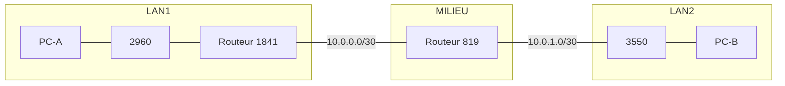

## Ordre de câblage

| Ordre | Liaison | Câble |
|---|---|---|
| 1 | PC-A vers 2960 Fa0/1 | Droit |
| 2 | 2960 Gi0/1 vers 1841 Fa0/0 (trunk) | Droit (supposé, non confirmé) |
| 3 | 1841 Fa0/1 vers 819 Gi0 | Croisé |
| 4 | 819 Fa0 vers 3550 Fa0/24 | Droit |
| 5 | 3550 Fa0/1 vers PC-B | Droit |

## Commandes tapées

### Switch 2960

```
enable
configure terminal
vlan 10
 name COMPTA
vlan 20
 name IT
vlan 30
 name HR
exit
interface range fa0/1-8
 switchport mode access
 switchport access vlan 10
interface range fa0/9-16
 switchport mode access
 switchport access vlan 20
interface range fa0/17-24
 switchport mode access
 switchport access vlan 30
interface gi0/1
 switchport mode trunk
end
write memory
show mac address-table dynamic
```

### Routeur 1841

```
enable
configure terminal
interface fa0/0
 no shutdown
interface fa0/0.10
 encapsulation dot1Q 10
 ip address 192.168.10.1 255.255.255.0
interface fa0/0.20
 encapsulation dot1Q 20
 ip address 192.168.20.1 255.255.255.0
interface fa0/0.30
 encapsulation dot1Q 30
 ip address 192.168.30.1 255.255.255.0
interface fa0/1
 ip address 10.0.0.1 255.255.255.252
 no shutdown
router rip
 version 2
 no auto-summary
 network 10.0.0.0
 network 192.168.10.0
 network 192.168.20.0
 network 192.168.30.0
 passive-interface default
 no passive-interface fa0/1
end
write memory
```

### Routeur 819

```
enable
configure terminal
vlan 99
 name TRANSIT
interface gigabitEthernet 0
 ip address 10.0.0.2 255.255.255.252
 no shutdown
interface fa0
 switchport mode access
 switchport access vlan 99
interface vlan 99
 ip address 10.0.1.1 255.255.255.252
 no shutdown
router rip
 version 2
 no auto-summary
 network 10.0.0.0
 passive-interface default
 no passive-interface GigabitEthernet0
 no passive-interface Vlan99
end
write memory
```

### Switch 3550

```
enable
configure terminal
ip routing
vlan 40
 name FIN
vlan 50
 name VENTES
vlan 60
 name DIRECTION
vlan 99
 name TRANSIT
interface range fa0/1 - 8
 switchport mode access
 switchport access vlan 40
interface range fa0/9 - 16
 switchport mode access
 switchport access vlan 50
interface range fa0/17 - 23
 switchport mode access
 switchport access vlan 60
interface fa0/24
 switchport mode access
 switchport access vlan 99
interface vlan 40
 ip address 192.168.40.1 255.255.255.0
interface vlan 50
 ip address 192.168.50.1 255.255.255.0
interface vlan 60
 ip address 192.168.60.1 255.255.255.0
interface vlan 99
 ip address 10.0.1.2 255.255.255.252
router rip
 version 2
 no auto-summary
 network 10.0.0.0
 network 192.168.40.0
 network 192.168.50.0
 network 192.168.60.0
 passive-interface default
 no passive-interface Vlan99
end
write memory
```

### Commandes de vérification

```
show ip route
show ip route rip
show ip protocols
show startup-config | include router rip
show startup-config | include network
```

### PC-A et PC-B

```
ping 192.168.10.1
ping 192.168.40.10
tracert 192.168.40.10
ipconfig
```

## Captures

### Connectivité locale avant RIP

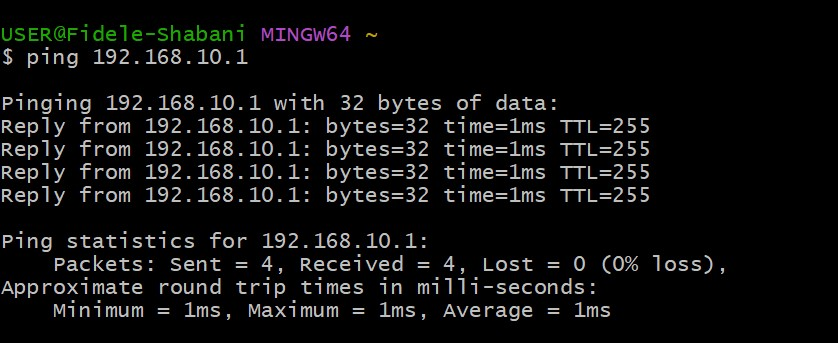

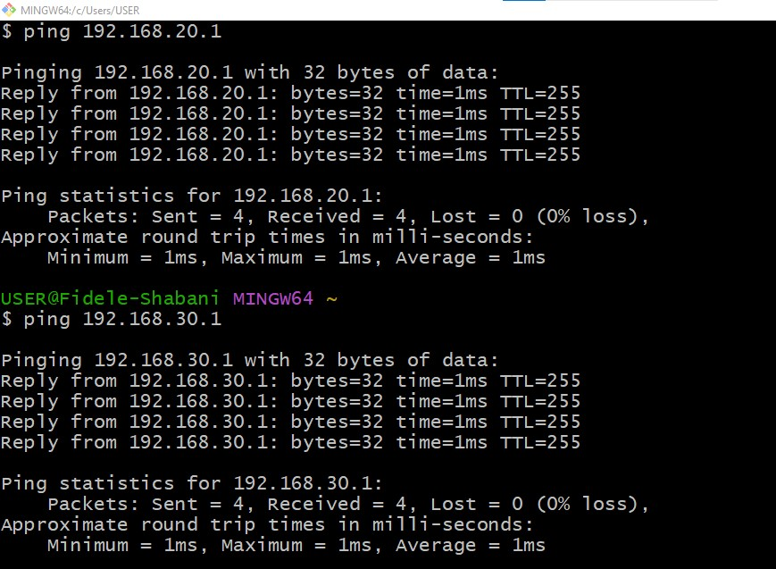

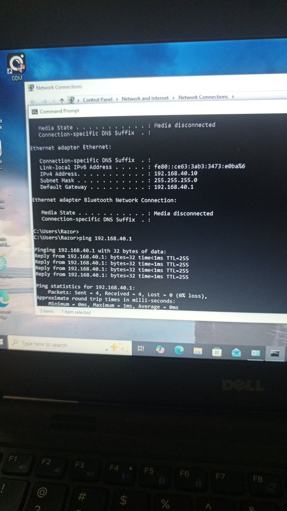

### Avant RIP : pas de route vers LAN2

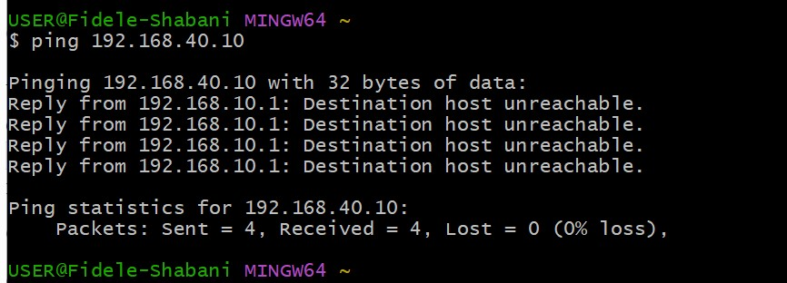

### Configuration RIP

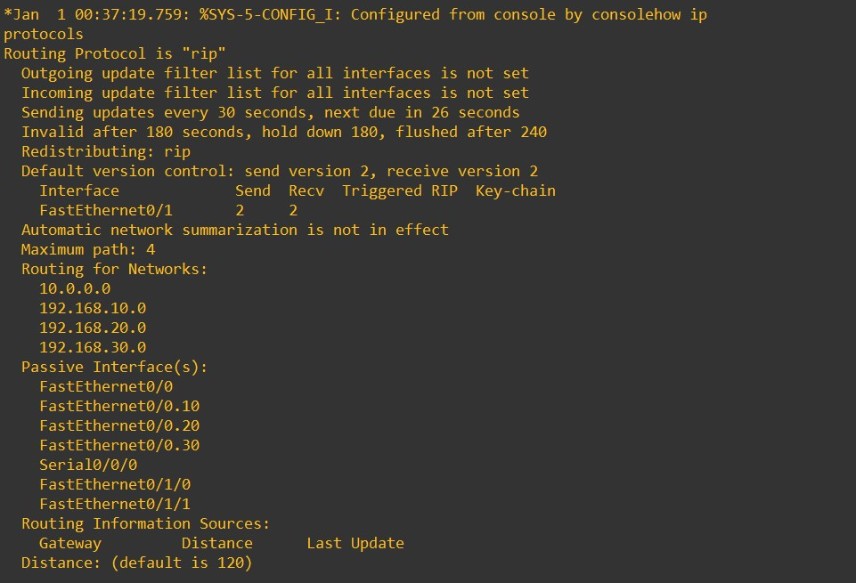

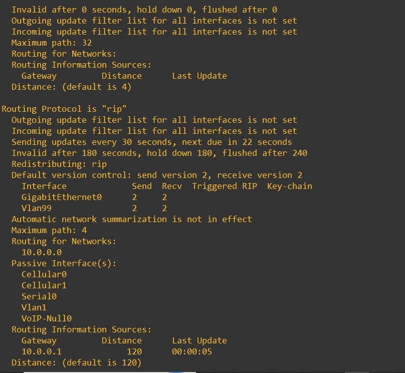

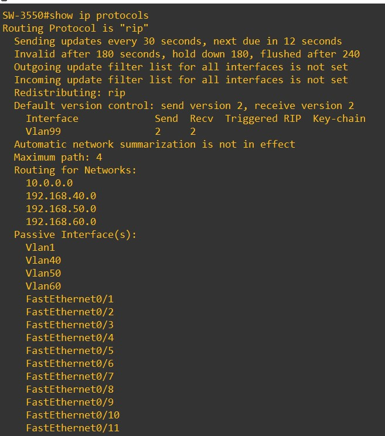

### Tables de routage

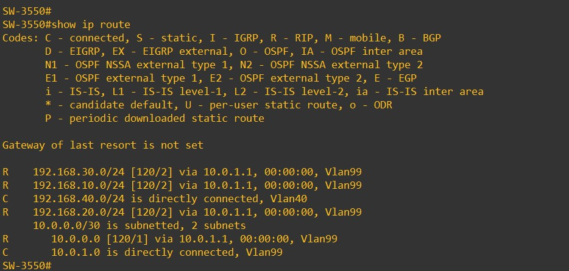

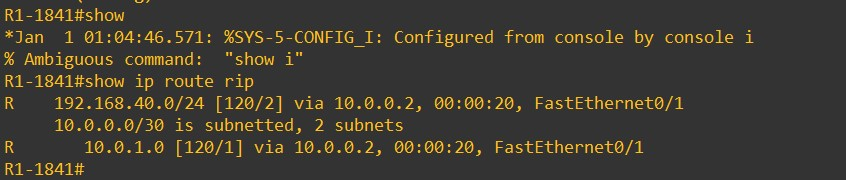

### Tests de bout en bout

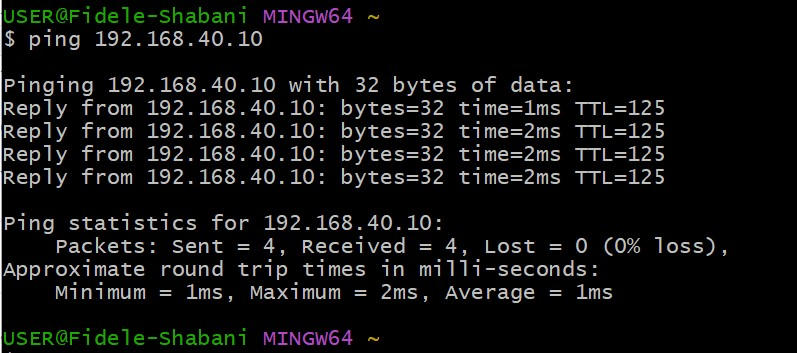

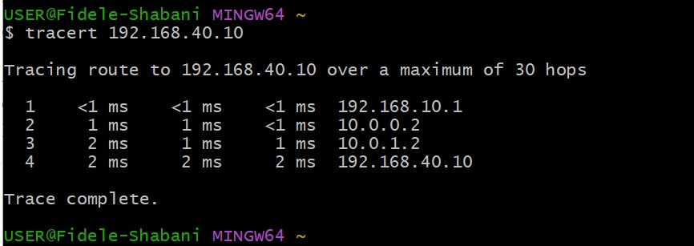

### Tables MAC

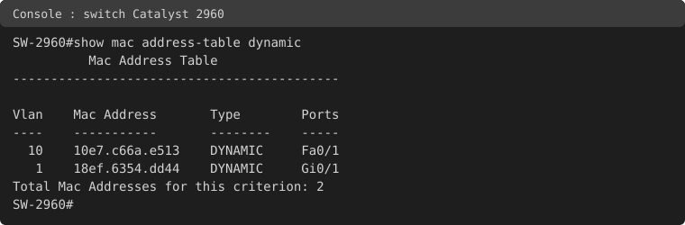

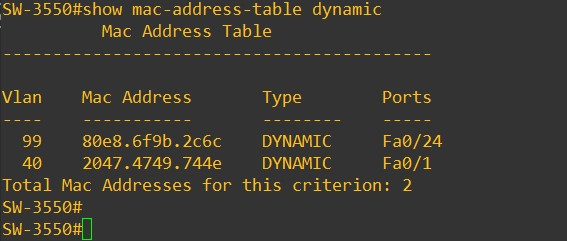

### Incident volontaire

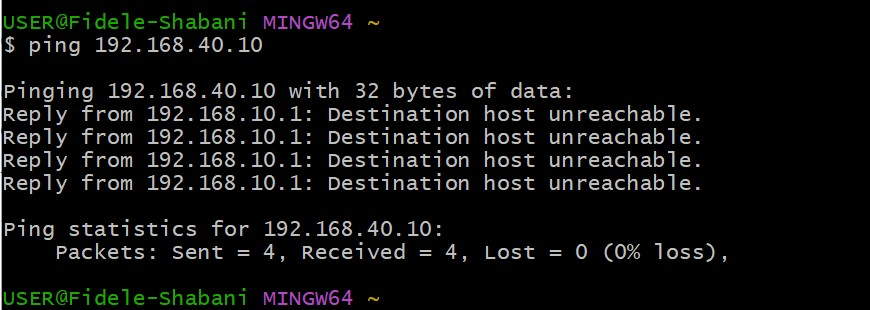

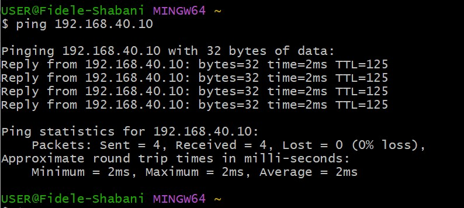

## Incident volontaire : interface passive sur le chemin RIP

**Action :** sur le 3550 (heure du 3550 : 01:24:11), `passive-interface Vlan99`, sans `write memory`.

**Symptôme :** après environ 4 minutes, le ping de PC-A vers PC-B (192.168.40.10) donne 4 "Destination host unreachable" venant de 192.168.10.1. Le résumé "Received = 4" est trompeur : il compte des messages d'erreur, pas des réponses.

**Diagnostic, du bas vers le haut :**

1. Couche 3 locale : le ping du 1841 vers 10.0.0.2 fonctionne.
2. `show ip route 192.168.40.10` sur le 1841 : `% Network not in table`. Le 1841 ne connaît plus le LAN2.
3. Le ping du 819 vers 10.0.1.2 fonctionne : le lien physique et IP est sain.
4. `show ip route rip` sur le 819 : seuls 192.168.10/20/30 en [120/1]. Le LAN2 n'est plus annoncé par le 3550.
5. `show ip protocols` sur le 3550 : Vlan99 est listée passive, mais 10.0.1.1 reste dans Routing Information Sources.

**Cause :** une interface passive continue de recevoir les mises à jour RIP, mais cesse de les envoyer. Le 3550 ne disait plus rien au 819, donc le LAN2 disparaissait des tables en amont.

**Réparation :** `no passive-interface Vlan99` sur le 3550. Le ping de PC-A vers PC-B refonctionne : 4/4, TTL 125.

Rien n'a été sauvegardé pendant l'incident : la configuration réparée est identique à la startup-config.

## Tests

| Test | Résultat |
|---|---|
| Ping PC-A vers 192.168.10.1 / 20.1 / 30.1 | OK, TTL 255 (le routeur répond lui-même) |
| Ping PC-B vers 192.168.40.1 | OK, TTL 255 |
| Ping PC-A vers PC-B avant RIP | 4 "Destination host unreachable" depuis 192.168.10.1 |
| `show ip route 192.168.40.10` sur le 1841 avant RIP | `% Network not in table` |
| Table du 3550 après RIP | R 192.168.10/20/30 [120/2] via 10.0.1.1, R 10.0.0.0 [120/1] |
| Table du 1841 après RIP | R 192.168.40.0/24 [120/2] via 10.0.0.2, R 10.0.1.0 [120/1] |
| Voisins RIP du 819 | 10.0.0.1 et 10.0.1.2 |
| Ping PC-A vers PC-B après RIP | 4/4, TTL 125 (128 moins 3 routeurs : 1841, 819, 3550) |
| Tracert PC-A vers PC-B | 192.168.10.1, 10.0.0.2, 10.0.1.2, 192.168.40.10 |
| Table MAC du 2960 | MAC de PC-A sur Fa0/1 en VLAN 10 |
| Incident : passive-interface Vlan99 sur le 3550 | Ping PC-A vers PC-B en échec |
| Après `no passive-interface Vlan99` | Ping PC-A vers PC-B 4/4, TTL 125 |

## Points ouverts

- Les réseaux 192.168.50.0 et 192.168.60.0 ne sont pas annoncés : leurs SVI sont up/down faute de port actif dans ces VLAN. Ils figurent dans la configuration RIP mais pas dans les tables des voisins.
- La table MAC du 2960 montre 18ef.6354.dd44 sur Gi0/1 en VLAN 1. Cette adresse n'a pas été identifiée, je ne l'attribue pas au 1841 sans preuve.
- Sur le 3550, 80e8.6f9b.2c6c est vue sur Fa0/24 en VLAN 99 : elle est supposée être celle du 819, non vérifiée.
- Le type de câble entre le 2960 et le 1841 est supposé droit, non confirmé.
- Les `passive-interface` ont été vérifiés dans la startup-config du 819 et du 3550, pas sur celle du 1841.
- Pas de photo du câblage pour ce projet.

## Ce que j'ai retenu

- RIP v2 : métrique en sauts, limite de 15, distance administrative 120, mises à jour toutes les 30 secondes.
- `network` prend une adresse classful, sans masque : il active RIP sur les interfaces concernées.
- `no auto-summary` est nécessaire pour annoncer des sous-réseaux discontigus.
- Une interface passive reçoit les mises à jour mais n'en envoie plus.
- Un SVI up/down n'est pas annoncé : il faut au moins un port actif dans le VLAN.
- "Received = 4" ne suffit pas : lire l'origine de chaque ligne de ping, et le TTL indique combien de routeurs sont traversés.
- Dépannage du bas vers le haut, et prouver la réparation par un test.

## Compétences démontrées

- Configuration de RIP v2 sur routeurs et sur switch de niveau 3.
- Router-on-a-stick et SVI dans une même topologie.
- Lecture des tables de routage et de `show ip protocols`.
- Diagnostic structuré d'une panne de routage dynamique.
- Documentation technique reproductible.

## Remise en état

Sur chaque équipement (switches et routeurs) : `erase startup-config` (ou `write erase`), `delete flash:vlan.dat` (sur le 819 aussi), puis `reload` en répondant "no" à la sauvegarde. Sur les PC : remettre l'Ethernet en IP automatique.
