# Accès internet d'un Windows Server 2019 derrière un routeur IPCop (VirtualBox)

Retour d'expérience : un Windows Server 2019 pouvait joindre son routeur **IPCop** mais pas internet (`ping 8.8.8.8` → *Destination host unreachable*). Ce dépôt documente le diagnostic, la cause, la correction, l'activation du DHCP et un aide-mémoire pour refaire la même démarche en cas de panne.

> Les captures de ce dépôt sont des **reconstitutions en SVG** des sorties réellement obtenues pendant le laboratoire (terminaux et schémas). Elles ne contiennent aucune donnée personnelle.

## Sommaire

1. [Architecture](#1-architecture)
2. [Symptôme](#2-symptôme)
3. [Diagnostic pas à pas](#3-diagnostic-pas-à-pas)
4. [Cause et correction](#4-cause-et-correction)
5. [Rendre les règles permanentes](#5-rendre-les-règles-permanentes)
6. [Accéder à l'interface web d'IPCop](#6-accéder-à-linterface-web-dipcop)
7. [Activer le DHCP d'IPCop](#7-activer-le-dhcp-dipcop)
8. [Aide-mémoire](#8-aide-mémoire)

---

## 1. Architecture

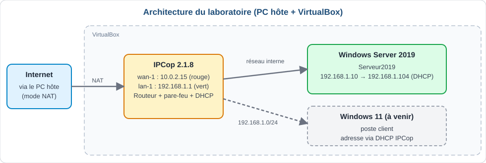

| Élément | Détail |
|---|---|
| Hyperviseur | Oracle VirtualBox sur le PC hôte |
| VM IPCop 2.1.8 | `wan-1` (rouge) : `10.0.2.15/24`, `lan-1` (vert) : `192.168.1.1/24` |
| VM Windows Server 2019 | Nom d'hôte `Serveur2019`, IP initiale fixe `192.168.1.10/24`, passerelle `192.168.1.1` |
| Réseau côté serveur | Réseau interne VirtualBox, même nom que la carte verte d'IPCop (configuration attendue) |
| VM prévue ensuite | Poste client Windows 11 |

## 2. Symptôme

- Le serveur répond au ping vers IPCop (`192.168.1.1`).
- `ping 8.8.8.8` échoue avec *Destination host unreachable*.

## 3. Diagnostic pas à pas

On avance du plus proche (le serveur) vers le plus lointain (internet) pour trouver où les paquets s'arrêtent.

### Étape 1 : vérifier la configuration IP du serveur

```bat
ipconfig /all
```

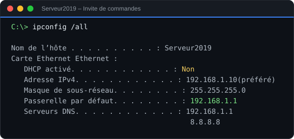

IP, masque, passerelle et DNS sont corrects : la panne est ailleurs.

### Étape 2 : identifier qui refuse le ping

```bat
ping 8.8.8.8
```

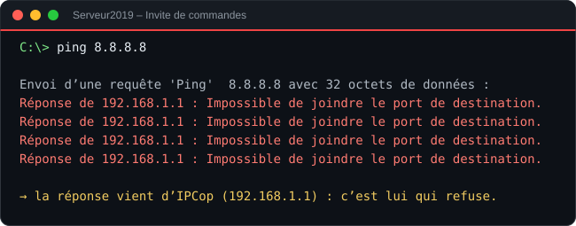

Les messages d'erreur viennent de `192.168.1.1`, donc d'IPCop : le serveur parle bien à son routeur, mais IPCop ne laisse pas passer le trafic.

### Étape 3 : lister les interfaces d'IPCop

Dans la console de la VM IPCop, connecté en `root` :

```sh
ifconfig -a
```

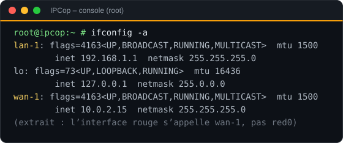

Sur cette version, l'interface rouge s'appelle `wan-1` et la verte `lan-1`. La commande `ifconfig red0` répond donc *Device not found*.

### Étape 4 : tester internet depuis IPCop

```sh
ping -c 4 8.8.8.8
```

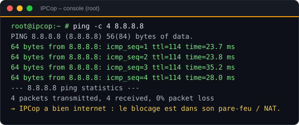

IPCop a bien internet : le blocage est entre le réseau interne et `wan-1`, dans le pare-feu ou le NAT d'IPCop.

### Étape 5 : examiner les chaînes iptables

```sh
iptables -L FW_OUTGOING -n -v
iptables -t nat -L REDNAT -n -v
```

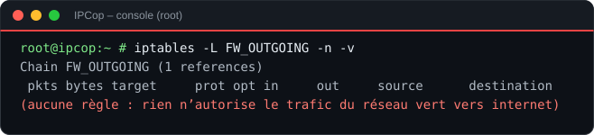

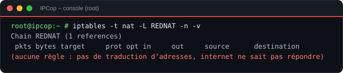

## 4. Cause et correction

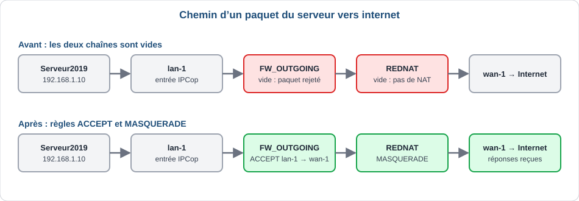

| N° | Cause | Effet |
|---|---|---|
| 1 | `FW_OUTGOING` est vide | Rien n'autorise le trafic du réseau vert vers internet, IPCop rejette les paquets |
| 2 | `REDNAT` est vide | Sans NAT, les paquets partent avec une adresse privée `192.168.1.x` et les réponses ne reviennent pas |

Après la première règle seule, le ping affiche *Délai d'attente dépassé* au lieu de l'erreur d'IPCop : les paquets partent mais les réponses ne reviennent pas, ce qui pointe vers le NAT.

Correction (temporaire, tant qu'IPCop n'est pas redémarré) :

```sh
iptables -I FW_OUTGOING -i lan-1 -o wan-1 -j ACCEPT
iptables -t nat -A REDNAT -s 192.168.1.0/24 -o wan-1 -j MASQUERADE
```

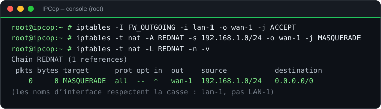

> **Attention :** les noms d'interface respectent la casse. `LAN-1` en majuscules ne fonctionne pas, il faut écrire `lan-1`.

Test depuis le serveur :

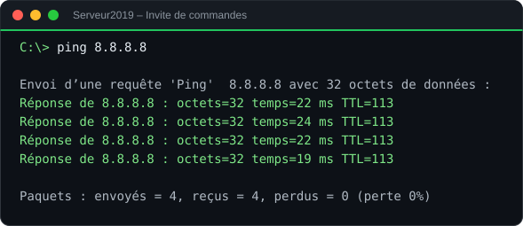

## 5. Rendre les règles permanentes

Les règles tapées en ligne de commande disparaissent au redémarrage d'IPCop. Le fichier prévu pour les règles personnalisées est `/etc/rc.d/rc.firewall.local` : IPCop l'exécute à chaque démarrage du pare-feu.

Il contient une section `start)` avec le commentaire `## add your 'start' rules here`. On y insère les deux règles :

```sh
sed -i "/add your 'start' rules here/a iptables -I FW_OUTGOING -i lan-1 -o wan-1 -j ACCEPT" /etc/rc.d/rc.firewall.local
sed -i "/add your 'start' rules here/a iptables -t nat -A REDNAT -s 192.168.1.0/24 -o wan-1 -j MASQUERADE" /etc/rc.d/rc.firewall.local
grep -n iptables /etc/rc.d/rc.firewall.local
```

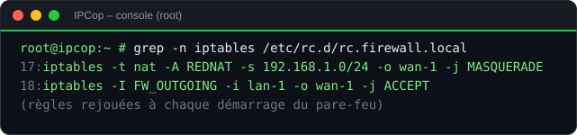

> **Piège rencontré :** lors de la première insertion, la ligne s'est retrouvée avec `-ilan-1` (espace manquant après `-i`), à cause du retour à la ligne du terminal. Toujours relire avec `grep`, puis corriger si besoin :
>
> ```sh
> sed -i 's/-ilan-1/-i lan-1/' /etc/rc.d/rc.firewall.local
> ```

Validation : redémarrer IPCop (`reboot`), puis refaire `ping 8.8.8.8` depuis le serveur. S'il répond, les règles sont bien permanentes.

## 6. Accéder à l'interface web d'IPCop

- Adresse : `https://192.168.1.1:8443`
- Elle n'est accessible que depuis le réseau vert : ouvrir le navigateur **dans la VM Windows Server**, pas sur le PC hôte (qui affiche *connexion refusée*).
- Utilisateur `admin` pour l'interface web, `root` uniquement pour la console de la VM IPCop.

Pièges rencontrés :

- **Erreur 401 « Authorization Required »** : le navigateur n'a pas affiché la fenêtre de connexion. Fermer complètement Internet Explorer, le rouvrir, puis se connecter avec `admin`.
- **Avertissement de certificat et sécurité renforcée d'Internet Explorer** : normaux avec IPCop. Cliquer sur *Fermer*, puis *Accéder à la page web (non recommandé)*.

## 7. Activer le DHCP d'IPCop

### Étape 1 : constater qu'aucun serveur DHCP ne tourne

```sh
ps aux | grep dhcp
```

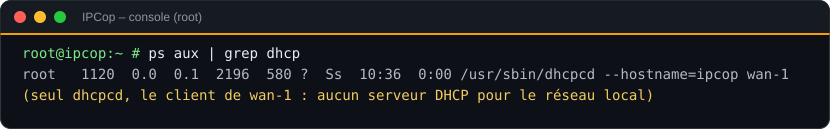

Seul `dhcpcd` apparaît : c'est le **client** DHCP de `wan-1`. Aucun serveur DHCP n'est actif pour le réseau local.

### Étape 2 : activer le serveur DHCP

Interface web : **Services** puis **Serveur DHCP**. Dans la section VERT, cocher **Activé**, laisser la plage `192.168.1.2` à `192.168.1.254` et le DNS primaire `192.168.1.1`, puis **Enregistrer**.

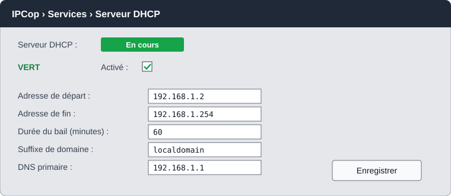

### Étape 3 : passer le serveur en adresse automatique

1. `Windows + R`, taper `ncpa.cpl`, valider.
2. Clic droit sur **Ethernet**, **Propriétés**, puis **Protocole Internet version 4 (TCP/IPv4)**.
3. Cocher **Obtenir une adresse IP automatiquement** et **Obtenir les adresses des serveurs DNS automatiquement**.
4. Contrôler avec `ipconfig /all`.

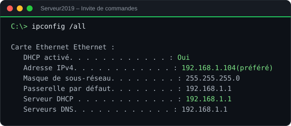

Le serveur reçoit `192.168.1.104`, avec la passerelle et le DNS `192.168.1.1`.

> **À retenir pour la suite :** si le rôle DHCP est installé sur Windows Server (avec une réservation pour le serveur), il faut d'abord **désactiver le DHCP d'IPCop** : deux serveurs DHCP sur le même réseau se perturbent mutuellement.

## 8. Aide-mémoire

Ordre conseillé si le problème revient :

1. Le serveur joint-il `192.168.1.1` ? Sinon, vérifier les cartes réseau dans VirtualBox (même nom de réseau interne des deux côtés).
2. IPCop joint-il `8.8.8.8` ? Sinon, le problème vient de `wan-1` ou de la carte NAT.
3. `FW_OUTGOING` et `REDNAT` contiennent-elles les règles ? Sinon, contrôler `rc.firewall.local`.
4. `ping 8.8.8.8` marche mais pas `ping google.com` ? Problème de DNS : vérifier le DNS du serveur.

| Commande | Où | Rôle |
|---|---|---|
| `ipconfig /all` | Serveur | IP, passerelle, DNS, état du DHCP |
| `ping 8.8.8.8` | Serveur | Tester la sortie vers internet (sans DNS) |
| `ping google.com` | Serveur | Tester internet avec résolution DNS |
| `ifconfig -a` | IPCop | Lister les interfaces (`lan-1`, `wan-1`) |
| `ping -c 4 8.8.8.8` | IPCop | Tester son propre accès internet |
| `iptables -L FW_OUTGOING -n -v` | IPCop | Règles de sortie du réseau vert |
| `iptables -t nat -L REDNAT -n -v` | IPCop | Règle NAT |
| `grep -n iptables /etc/rc.d/rc.firewall.local` | IPCop | Vérifier les règles permanentes |
| `ps aux \| grep dhcp` | IPCop | Voir si un serveur DHCP tourne |

Règles permanentes à retrouver dans `/etc/rc.d/rc.firewall.local` :

```sh
iptables -t nat -A REDNAT -s 192.168.1.0/24 -o wan-1 -j MASQUERADE
iptables -I FW_OUTGOING -i lan-1 -o wan-1 -j ACCEPT
```

## Structure du dépôt

```text
.
├── README.md
├── docs/
│   └── img/          # captures et schémas au format SVG
└── scripts/
    └── gen_svg.py    # script qui génère les SVG
```
